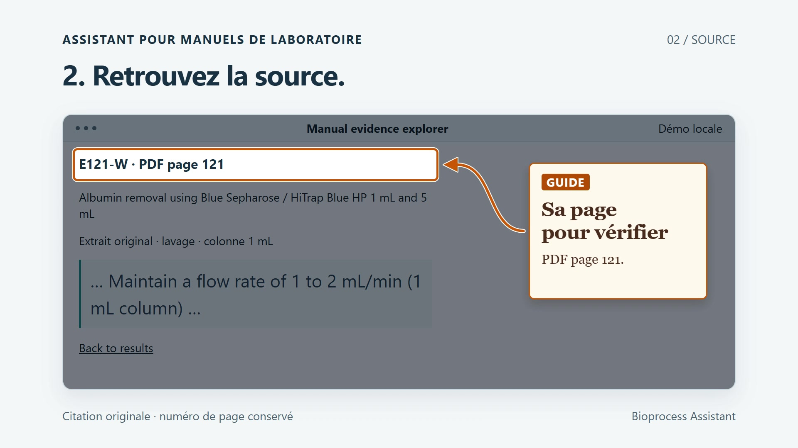

# Bioprocess Troubleshooting Assistant

A demonstrator for **troubleshooting Protein A capture chromatography**. Describe a symptom, retrieve documented possible causes and corrective actions, and inspect their handbook citations.

For example: *“My column pressure is unusually high. What should I check?”* The assistant searches a small curated knowledge graph and displays stored facts selected by the model. Possible causes are documentary hypotheses, not a diagnosis.

The project explores two engineering questions: how to constrain an assistant to traceable knowledge, and how to turn public technical manuals into reviewable, source-linked records. It is a development project, **not a scientifically validated or GxP-qualified system**.

[Watch the demo](#watch-the-demo) · [Architecture](#architecture) · [Run locally](#run-locally) · [Validation](#validation-and-results) · [Documentation](#documentation)

## Watch the demo

[](https://github.com/mukunde/bioprocess-assistant/raw/refs/heads/main/media/cytiva-onboarding-v05/exports/onboarding.mp4)

[▶ Open the video (34 seconds · MP4, 2.6 MB)](https://github.com/mukunde/bioprocess-assistant/raw/refs/heads/main/media/cytiva-onboarding-v05/exports/onboarding.mp4) · [Editable sources and credits](media/cytiva-onboarding-v05/README.md)

Follow a guided request, verify its quotation and page, and see how clarification
and quarantine are displayed. Understandable without sound, with French guidance
and the actual English interface. This local demo uses **25 reviewed excerpts**
without an LLM or database; it is separate from the Neo4j troubleshooting chat.

GitHub serves this MP4 as a download. Open the downloaded file in your video player.

## Current status

Updated 27 October 2026. The merged checkpoint is `main` at `4b2bfa5`, including
[PR #51](https://github.com/mukunde/bioprocess-assistant/pull/51) (v03 runtime freeze),
[PR #52](https://github.com/mukunde/bioprocess-assistant/pull/52) (guided demo and usability fixes)
and [PR #53](https://github.com/mukunde/bioprocess-assistant/pull/53) (Windows launcher),
followed by [PR #55](https://github.com/mukunde/bioprocess-assistant/pull/55)
(isolated Windows installation and verified tokenizer setup).
The complete maintained suite passed **790/790 tests** on that merged baseline,
with no skipped tests or external connection attempts.

The merged v02/FV trial preserves all twelve human approvals and its completed
one-pass comparison. The structured arm passes
**22/24**, free text **17/24** (EN 10/12, FR 7/12), and **7/12 bilingual pairs**
pass. Acceptance is not met. FV06 fails both arms only on a shared coverage flag;
its individual unit states match the reference. See the
[compact FV package](experiments/cytiva/free-text-v02-comparison-v01/README.md).
The failures informed corrected v03; they were not rescored. No experimental
interpreter is the legacy chat default.

**Merged and demonstrable locally:** corrected v03 is frozen with 36 pinned files.
The free guided demo uses 25 reviewed excerpts to display documentary support,
source quotations, clarification, missing evidence and quarantine without a model
or Neo4j. Usability corrections and a Windows launcher with dependency/cache and
freeze checks are merged. The separate Windows installer is also merged: it creates
an isolated environment, installs 12 hash-locked dependencies and prepares the
verified tokenizer cache. Setup and the walkthrough passed in a fresh clone on
the same PC; validation on a second physical machine remains pending. See
[the demo-first guide](docs/DEMO-FIRST.md).

| Component | Status and scope |
|---|---|
| Troubleshooting chat | Implemented: six curated Protein A symptoms, English full-text Neo4j retrieval, Anthropic tool use and application-controlled rendering |
| French and English questions | Agent selects English search phrases; headings/refusals are localized and technical graph facts remain in English |
| Local PDF ingestion | Experimental Docling Graph/Ollama route with structural chunking, localization and review UI; separate optional evidence publication |
| Reviewed manual extraction | Merged development example: 33 statements reviewed on pages 100–102, with 14 reservations; not served by the chatbot |
| Conversion and chunking | Selected page 77/88/104/152–153 reviews and repairs are merged; three ambiguous rows remain quarantined on 152–153 |
| Passage retrieval | Merged BM25/atomic assembly experiments; frozen v03b, v04 and v05 gates remain blocked and none is the chat default |
| Structured request control | Merged offline control. S01-S12: all 24 EN/FR submissions and all 12 paired scenarios pass reviewed context/diagnostic criteria; known-corpus diagnostic evidence only |
| Free-text interface and local demo | v01/v02, reviewed FT/FV trials, corrected opt-in v03, its runtime freeze, corrected guided/text demo, Windows installer and launcher merged. Same-PC fresh-clone setup verified; second-machine validation pending. Historical gates remain blocked |
| Reviewed records → chatbot | Adapter pending; ingestion does not automatically enrich the serving graph |
| Observability and evaluation extensions | OpenTelemetry, Ragas and Promptfoo remain pending; LightRAG is a comparison candidate and KAG remains conditional |

The current chat model is configured as `claude-sonnet-4-6` in [agent.py](agent.py). The separate reviewed extraction used GPT-6.1 Sol through a subscription interface; that subscription does not fund the chatbot's API calls.

## Architecture


**Solid arrows** show implemented paths. **Dashed coral arrows** show planned connections. Read ingestion and storage at the top, then the serving loop below:

1. Chainlit sends the question to the agent.
2. The agent calls `query_graph` with an English symptom phrase. Neo4j searches the English symptom index and traverses `Symptom → INDICATES → Cause → RESOLVED_BY → Action` using parameterized Cypher.
3. The model selects retrieved result IDs. Application code validates the selection and renders stored facts and citations. Unsupported selections, missing knowledge and operational errors have separate handling.

Free-form model advice is not displayed. This constrains generation, but does not guarantee relevant retrieval or scientifically correct source material. A Lucene score measures lexical relevance, not diagnostic confidence.

Ingestion has two separate routes: **Docling → Docling Graph + local Ollama → review**, and the completed **Docling → GPT-6.1 Sol → checks and human review** experiment. Local chunking follows document structure and hierarchy, then token budgets; the reviewed three-page experiment used its full input without automatic chunking. Neither route currently feeds the chatbot.

[Full-size SVG](docs/architecture/architecture-detailed.svg) · [Diagram notes and logo sources](docs/architecture/README.md) · [Grounding decision](docs/ADR-001-knowledge-graph-grounding.md)

## Run locally

### Local Cytiva demo (Windows)

For a fresh Windows x64 clone, install CPython **3.13.0** separately, then run
`.\Install-CytivaDemo.ps1` to create `.venv-demo`, install hash-locked dependencies
and prepare the verified tokenizer cache. The installer is merged; see the
[setup guide](docs/DEMO-FIRST.md#install-from-a-fresh-windows-clone)
for prerequisites and offline installation.

The Windows launcher finds a compatible local Python environment, checks the
frozen dependency versions and offline tokenizer, verifies v03 and starts the demo.
From the repository root:

```powershell
.\Install-CytivaDemo.ps1
.\Start-CytivaDemo.ps1 -CheckOnly
.\Start-CytivaDemo.ps1
```

Open [localhost:8766](http://127.0.0.1:8766/). Start with washing flow, then add
maximum pressure and equilibration flow to inspect partial service. It uses no
model or database. The explicit installer downloads packages and tokenizer data;
the launcher and running demo do not install or download anything. The
[demo guide](docs/DEMO-FIRST.md) covers `-CheckOnly`, `-PythonPath`, `-Port`, the
walkthrough and prerequisites for another machine. Ctrl+C stops the local server.

### Existing Chainlit/Neo4j chat

The reference workstation uses **Windows, Python 3.13 and Docker Desktop**. The application Dockerfile targets Python 3.11. These are documented configurations, not a cross-platform certification. PDF ingestion uses a separate optional environment.

The commands below use PowerShell and run the application on the host, with Neo4j in Docker. Install Git, Python 3.13 and Docker Desktop first; start Docker Desktop before starting the database.

### 1. Install the application

```powershell
git clone https://github.com/mukunde/bioprocess-assistant.git
cd bioprocess-assistant
py -3.13 -m venv .venv
.\.venv\Scripts\python.exe -m pip install -r requirements.txt
if (-not (Test-Path .env)) { Copy-Item .env.example .env }
```

### 2. Configure local services and authentication

Edit the ignored `.env`. Its template still contains Aura placeholders: replace the four database settings with the local values below and choose a password **before the first database start**.

```dotenv
NEO4J_URI=bolt://127.0.0.1:7687
NEO4J_USERNAME=neo4j
NEO4J_PASSWORD=replace_with_a_local_password
NEO4J_DATABASE=neo4j
```

For real chat requests, set `ANTHROPIC_API_KEY`. Generate the Chainlit signing secret:

```powershell
.\.venv\Scripts\chainlit.exe create-secret
```

Copy the generated value into `CHAINLIT_AUTH_SECRET` in `.env`, then set `DEMO_USERNAME` and `DEMO_PASSWORD` for the login screen. Replace all placeholders; keep credentials in the ignored `.env`. Offline regressions need no API key or running Neo4j.

### 3. Start Neo4j and load the seed

```powershell
docker compose -f compose.neo4j.yaml up -d --wait
.\.venv\Scripts\python.exe scripts/load_graph.py
```

The loader creates constraints and the English full-text index, waits for indexes and applies seed updates transactionally while preserving unrelated records. Changing `.env` later does not change an existing database password. Persistent Docker storage and connection troubleshooting are covered in the [local Neo4j guide](docs/LOCAL-NEO4J.md).

### 4. Start the interface

```powershell
.\.venv\Scripts\chainlit.exe run app.py -w
```

Open [localhost:8000](http://localhost:8000) and log in with the credentials you configured. Try *“My capture yield has dropped”* or *“La pression de ma colonne est anormalement élevée.”* The settings slider adjusts the lexical threshold; lowering it can admit weak matches.

Stop the database when finished:

```powershell
docker compose -f compose.neo4j.yaml stop
```

For an application container, configure a database address reachable **from that container**: `127.0.0.1` would refer to the application container itself. The host-based setup above avoids that mismatch. The [Dockerfile](Dockerfile) is available; hosted infrastructure and credentials require their own configuration.

## Validation and results

Install the additional test dependencies into the application environment:

```powershell
.\.venv\Scripts\python.exe -m pip install -r eval/requirements.txt -r requirements-structured.txt
.\.venv\Scripts\python.exe -m unittest tests -v
```

The [current suite notes](tests/README.md) explain the maintained entry point and preservation of frozen historical fixtures.

These tests mock external model/database calls; some use loopback HTTP servers
and Windows asynchronous sockets. They need no paid API or external service.
The **790/790** merged-main result above is from the existing local verification
environment, not a clean-OS certification or an answer-quality measurement.
The separate demo setup also passed in a fresh clone on the same PC. Its twelve
dependencies and wheel hashes are in `demo/requirements-windows.lock`; its installer
prepares the public tokenizer asset with the frozen hash. Other structured runtime
workflows use `requirements-structured.txt` and may need their own local cache setup.

The merged structured export can be verified with only the standard library,
without PDFs, tokenizer assets, credentials, models or private run files:

```powershell
python -S -m experiments.cytiva.verify_structured_reviewed_package
python -S -m unittest tests.test_structured_reviewed_package -v
```

These commands inspect saved evidence; they never rerun S01-S12. The merged
EN/FR runtime has IF01–IF14 conformance and regression checks. The merged FV
package adds static freeze/review/export guards; passing tests or reviewed forms
does not establish general language understanding or generated-answer quality.

| Development evidence | What it establishes | Limits |
|---|---|---|
| [Reviewed extraction, pages 100–102](experiments/cytiva/reviewed-r2/README.md) | 33 corrected statements: 19 validated and 14 validated with reservations; decisions and hashes preserved | Documentary review only; no exhaustive recall, scientific approval or publication |
| [Page 77 review](experiments/cytiva/reviewed-page-077/README.md) and [page 88 review](experiments/cytiva/reviewed-page-088/README.md) | Species/header scope, pH, remarks, reconstructed product cells and five notes reviewed with reservations | Original conversion defects remain documented; targeted repairs do not fix Docling generally; table-only retrieval may omit adjacent context |
| [Figure 104 review](experiments/cytiva/reviewed-page-104/README.md) | Image/caption, five paths, alternative role, applicability and K0/K800 text conservation reviewed | Human interpretation is not native extracted graph edges; automatic text-only diagram semantics remain quarantined |
| [Pages 152–153 annotated review](experiments/cytiva/reviewed-pages-152-153-v2/README.md) | Continued table, repaired HiTrap/HiScreen row and reviewed note annotations retained in new chunks | Three ambiguous rows remain physically separated in quarantine; no complete property-cell or production retrieval validation |
| [Cleaning retrieval](docs/experiments/cytiva-retrieval-depth-results.md) | Six-hit candidate supplies all required sources for Q01–Q10 and N01–N08 in both languages, under a 2,048-token context cap | Known development questions; additional context is not proven more precise; no generated answers evaluated |
| [Contaminant context ablation](docs/experiments/cytiva-contaminants-context-results.md) | On C01–C10, section context raises complete evidence from 6/10 to 10/10 in both languages; combined vocabulary/context also reaches 10/10 | Tuned after inspecting failures; no independent generalization or answer-quality result; E118-I and E121-EQ remain pending and excluded |
| [Frozen v03b / V01-V12](experiments/cytiva/reviewed-v03b-evaluation/README.md) | Twelve reviewed references; 24 saved contexts; 6/12 intents have complete evidence in both languages, but only V02/V05/V09 also respect explicit scope | Merged; acceptance gate blocked. Source omissions and unrequested phases remain visible; no generated answers evaluated |
| [v04 development A-D](experiments/cytiva/compositional-navigation-v04-results/README.md) | Composes requests and handles bounded negations; final known-case coverage V12/12, H10/10, C10/10 in both languages; no unrequested or outside-acceptable V context | Merged development result after inspecting failures; no independent validation or default activation. One optional V03 seed still exceeds the six-seed cap |
| [Frozen v04 / W01-W12](experiments/cytiva/reviewed-v04-evaluation/README.md) | Merged review and 24 saved contexts: 8/12 intents evidence-complete in both languages, but only W10/W11 satisfy completeness, explicit scope and diagnostics | Gate blocked: 13/24 explicit scope failures and 2/24 diagnostic failures; no generated answers evaluated |
| [v05 development A-B](experiments/cytiva/polarity-navigation-v05-results/README.md) | Merged known-case coverage W12/12, V12/12, H10/10, C10/10; both attempts retained, including intermediate C02 failure | Tuned after inspecting W failures; not prospective validation or default activation; absent H/C scope annotations remain unavailable |
| [Frozen v05 / X01-X12](experiments/cytiva/reviewed-v05-evaluation/README.md) | Merged compact export: 12 reviewed intents and 24 contexts; EN 8/12, FR 7/12 complete; only X02/X05/X09 satisfy all scope/diagnostic criteria in both languages | Gate blocked: 9/24 explicit scope failures and 6/24 diagnostic failures; task ownership, nested negation and routing/lexical disagreement remain unresolved |
| [Structured S01-S12 trial](experiments/cytiva/reviewed-structured-control/README.md) | Merged: 12 human-reviewed scenarios, all 24 saved submissions pass context/diagnostics; no EN/FR semantic divergence; 348–1,504 context tokens | Structured intent control on known sources/code, not free-text or generated-answer validation; E118-I/E121-EQ remain excluded |
| [Free-text design and grouped examples](docs/technical/FREE-TEXT-MACHINE-DESIGN-V01.md) | CP/FI/MC decisions, GR01–GR04 review and deterministic EN/FR runtime merged | Bounded offline interface; no default chat activation or source approval |
| [Frozen v01 / FT01-FT12](experiments/cytiva/free-text-comparison-v01/README.md) | Merged: S 24/24, F0 12/24 observations and 4/12 bilingual pairs | Acceptance blocked; inspected FT cases became v02 development regressions |
| [Opt-in v02](docs/technical/FREE-TEXT-CANDIDATE-V02.md) | Merged candidate; 57 targeted checks and FT development regressions pass | Does not replace v01 or demonstrate independent performance |
| [Frozen v02 / FV01-FV12](experiments/cytiva/free-text-v02-comparison-v01/README.md) | Merged reviewed delivery: S 22/24, F0 17/24, 7/12 pairs; 48 outcomes retained; 1,674-token maximum | Gate blocked by item identity, FR phase association and FV06 shared-flag/reference mismatch. No reference amendment or rescoring |
| [Corrected v03](docs/technical/FREE-TEXT-CANDIDATE-V03-REVIEW-FIXES.md) | Merged: versioned coverage, buffer occurrences and French phase-origin fixes; 76 v03 checks pass; [runtime freeze](experiments/cytiva/free-text-v03-freeze-v01/README.md) pins 36 files | Known development regressions and runtime integrity, not a new prospective score or legacy chat activation |
| [Guided demo and Windows setup](docs/DEMO-FIRST.md) | Merged: request-to-source walkthrough, usability corrections, isolated hash-locked installation and launcher checks; seven browser/HTTP scenarios and five exact displayed quotations checked | Same-PC fresh-clone evidence; second-machine/clean-OS validation pending. 25-excerpt scope; no generated advice or whole-manual coverage |
| [Evaluation contract](eval/README.md) | 33 development cases covering scope, refusals and grounding | Existing cases and historical results are not independent validation |

The question series have distinct histories: Q/N/C contain 28 reviewed development
intents; H, V, W, X, FT and FV add reviewed same-corpus challenges. Inspected failures
subsequently become development/regression inputs. EN/FR formulations are paired,
source facts overlap, and the author knows the implementation: these are not
independently authored or new-manual evaluations. Do not compare v04's W score
with v05's X score, or FT with FV, as though they were the same questions.

The [X review and blocked outcome](docs/experiments/cytiva-v05-prospective-results.md)
are merged historical evidence. Their failures motivated the now-implemented
structured request contract/control. The separate S trial passes its own
reviewed structured references; it does not retroactively repair X or prove that
free text is understood. S and X are different diagnostic experiments, not a
controlled before/after answer-quality comparison.

E118-I and E121-EQ remain excluded. Pressure absence is bounded to 25 eligible
excerpts, not the full manual. S's 2,048-token budget counts serialized context
including bindings, not a future answer prompt or output. The source-reviewed
claims have not been connected to the chatbot's serving path.

**Next priority:** reproduce the model-free demo from a fresh clone on a second
Windows PC using the merged installer and existing guide, without copying the
prepared environment or tokenizer cache. Success requires `-CheckOnly`, citations
and warnings, missing-format clarification, partial service and quarantine to work;
retain setup diagnostics and the Python/Windows versions. This is a portability
check, not another installer implementation or question-review campaign. Preserve
frozen v03, historical blocked scores and excluded sources.

The three-arm graph/passages/LightRAG comparison remains unexecuted. Current BM25
trials are a lexical baseline, not the multilingual vector arm specified in that
protocol. OpenTelemetry, Ragas and Promptfoo are not integrated yet.

With Neo4j running, `python eval/run_eval.py` evaluates the eligible English lexical subset without model calls. `--agent` additionally calls Anthropic for the assistant and judge and incurs API costs; it is a separate, deliberate evaluation step.

The [conversion/chunking launcher](experiments/cytiva/README.md#local-table-conversion-and-chunking-no-llm) runs without extraction LLMs or paid APIs, using the selected manual and cached weights. General local extraction and manual review have separate [installation and workflow instructions](docs/INGESTION.md).

Manuals and raw experiment outputs stay local and ignored. A fresh clone includes code, curated reports and the selected review package, but not PDFs, model weights or full local journals. The demo has a Windows x64 wheel-hash lock; other requirements files are not a complete project-wide dependency lock.

## Next steps

1. Validate the merged installer on a second Windows PC from a fresh clone: isolated dependencies, newly prepared verified tokenizer cache, launcher `-CheckOnly`, then the existing five-minute walkthrough. Keep frozen v03 unchanged and record setup failures explicitly.
2. Record a short demonstration and collect user feedback. Setup and launch are implemented; improve usability and bounded language coverage from concrete feedback.
3. Extend one confirmed troubleshooting workflow or the reviewed-records-to-chatbot adapter, retaining source versions, conditions, reservations and quarantine.
4. Instrument the actual path with OpenTelemetry and portable call/retry/cost accounting; add generated-answer evaluation with Ragas and Promptfoo when that answering path exists. Fresh holdouts accompany later behavior changes.
5. Compare graph/passages/LightRAG on a common corpus and budget after adapters and references exist. Keep KAG and fine-tuning conditional on measured needs.

The FT and FV free-text comparisons have executed; the architecture comparison
remains unexecuted. No additional whole-manual page review is required unless a
measured failure or newly required format exposes a concrete conversion gap.

The [active roadmap](docs/ROADMAP.md) defines acceptance criteria. The earlier vector experiment is recorded in [ADR-002](docs/ADR-002-multilingual-retrieval.md); it does not settle the planned comparison on a larger reviewed corpus.

## Documentation

Use the [documentation index](docs/README.md) for the ontology, claim contract, experiment protocols, operational guides and delivery history. The implementation separates [agent/tool use](agent.py), [validated rendering](grounding.py), [graph retrieval](tools.py), [ingestion](ingestion/) and [evaluation](eval/).

Reference hosted demo: [bioprocess-assistant.onrender.com](https://bioprocess-assistant.onrender.com). Its authenticated end-to-end behaviour has not been verified; local setup is the documented development path. For a walkthrough, contact [Gaël Mukunde](mailto:gaelmukunde@gmail.com) or connect on [LinkedIn](https://www.linkedin.com/in/gaelmukunde/).

## License

Project code: [MIT](LICENSE). Source manuals and technology logos retain their respective rights; the manuals are not redistributed in this repository.
