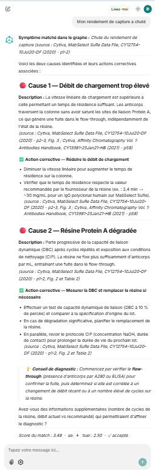
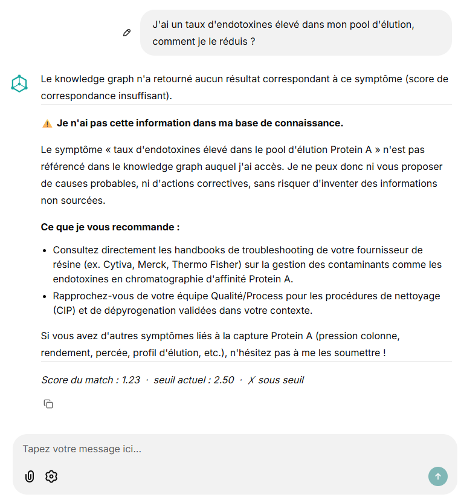
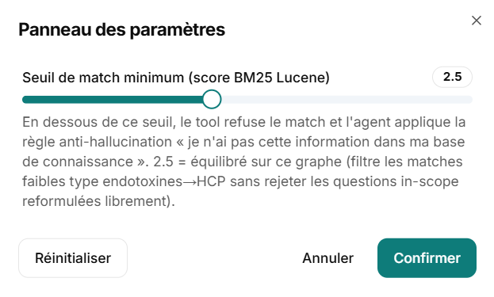
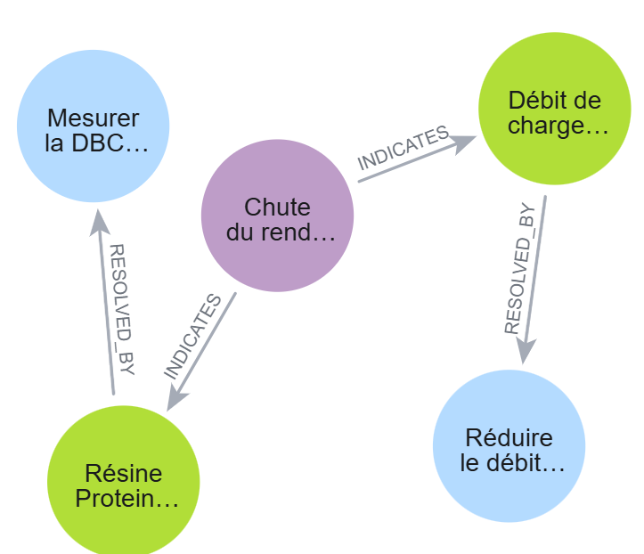

# Bioprocess Troubleshooting Assistant

An AI assistant demonstrator for **troubleshooting Protein A capture chromatography** (a downstream bioprocess unit operation). Given a symptom described in natural language, the agent returns the probable causes and corrective actions - answers rendered from selected knowledge graph facts with handbook citations. Possible causes are documentary hypotheses, not a diagnosis.

The project validates a simple hypothesis: *can we build an agent a process engineer would find credible, with verifiable citations and zero tolerated hallucination, in the regulated context of biopharma?*

> **Language note:** ask in French or English. Headings and refusals follow that language; technical facts are rendered verbatim in the English graph language. Reviewed translations are a future extension.

> **Reliability update:** model prose is never displayed. The agent selects retrieved result IDs; application code validates them and renders graph facts and citations. This limits unsupported generation, but does not guarantee correct retrieval or scientifically validated knowledge. See [evaluation instructions](eval/README.md) for the checks and their limits.

## Project documentation and experiments

All four implementation lots are merged into `main`:

| Lot | Available functionality | Pull request |
|---|---|---|
| 1 | Validated graph-only rendering, reliable evaluation, model/Neo4j error handling and local Neo4j setup | [#3](https://github.com/mukunde/bioprocess-assistant/pull/3) |
| 2 | Optional Docling Graph PDF ingestion, immutable provenance, manual review and separate evidence-graph publication | [#4](https://github.com/mukunde/bioprocess-assistant/pull/4) |
| 3 | Minimal documentary ontology, v0.2 extraction contract, evidence checks and explicit source quarantine | [#5](https://github.com/mukunde/bioprocess-assistant/pull/5) |
| 4 | Consolidated documentation, Cytiva experiment tooling and safe v0.2 PDF test preparation | [#6](https://github.com/mukunde/bioprocess-assistant/pull/6) |

The README update is also merged through [#7](https://github.com/mukunde/bioprocess-assistant/pull/7).

Start with [PDF ingestion and review](docs/INGESTION.md), the
[local Neo4j guide](docs/LOCAL-NEO4J.md), the
[minimal ontology](docs/ontology/v0.1.md) and the
[v0.2 claim contract](docs/CLAIM-CONTRACT-V02.md).

GPT-6.1 Sol is the provisional strong extractor for rare public-manual ingestion,
based on the initial comparison. The interactive assistant's model remains a
separate configuration. Subscription-based extraction experiments do not configure
or fund the chatbot's API calls.

**Included in a fresh clone:** consolidated [documentation](docs/README.md),
[Cytiva experiment tooling](experiments/cytiva/README.md) and the
`ingestion.prepare_claim_test` PDF test launcher. The corrected-prompt r2 test on
pages 100–102 is complete: **33 reviewed claims, 19 validated and 14 validated with
reservations**. The [curated review package](experiments/cytiva/reviewed-r2/README.md)
includes the final candidate, decisions, provenance hashes and offline checks.
It is development evidence, without scientific validation, exhaustive recall scores
or publication authorization. The earlier-prompt package remains unexecuted.
Manuals, conversions, raw responses and full review journals remain local and ignored.

## Live demo

Reference demo URL: [bioprocess-assistant.onrender.com](https://bioprocess-assistant.onrender.com). Its current availability has not been revalidated after the local Neo4j migration.

Access is password-protected to keep usage under control (the agent consumes API tokens on every request). **Demo credentials are available on request** - reach me by email ([gaelmukunde@gmail.com](mailto:gaelmukunde@gmail.com)) or on [LinkedIn](https://www.linkedin.com/in/gaelmukunde/).

> ℹ️ Hosted on Render's free tier: the first request after a period of inactivity can take ~30 s (container cold start). A hosted demo also needs its own working Neo4j connection; the local database below is accessible only from the PC.

## Preview

Screenshots below illustrate the earlier free-form demo; the validated renderer now uses a fixed layout.

**Sourced answer** - from a natural-language symptom, the agent returns the probable causes and corrective actions, each citing its source (handbook page). The answer footer shows the match score and the current threshold.



**Anti-hallucination guardrail** - for a symptom absent from the graph (here, endotoxins), the agent explicitly declines rather than inventing an answer.



**Adjustable match threshold** - the slider exposes the Lucene score threshold at runtime, illustrating the retrieval precision / recall trade-off.



## Three target architecture layers

This POC implements only the causal layer. The other two are the natural evolution toward a real industrial use.

| Layer | What it models | Approach | Status |
|---|---|---|---|
| **Causal** | Symptom → Cause → Action | Hand-curated Neo4j knowledge graph + Claude agent | ✅ this POC |
| **Topological** | Equipment, connections, instrumentation | ChatP&ID pattern (extraction from P&IDs) | Future |
| **Operational** | Phases, states, KPIs, alarms | *Fabric IQ*-style ontology over an industrial data fabric | Future |

The central challenge in moving from a single-layer POC to a multi-layer system is **entity alignment**: ensuring the same column C-101 is the same node (or explicitly linked nodes) across all three layers, with an unambiguous shared identity.

## POC architecture

A minimal walking skeleton in three decoupled bricks:

1. **Neo4j knowledge graph** (local Docker instance, or a separately configured Aura instance) - domain knowledge modeled as `(:Symptom)-[:INDICATES]->(:Cause)-[:RESOLVED_BY]->(:Action)`. Every node carries a mandatory `source` field pointing to a precise page of a public handbook.
2. **Claude agent** (Anthropic SDK, Sonnet 4.6) with a single exposed tool: `query_graph(symptom)`. The model returns a JSON selection of retrieved result IDs. `grounding.py` validates that selection and renders complete, sourced graph paths; invalid output produces a fixed refusal and an evaluation error.
3. **Chainlit UI** that routes user messages to the agent.

The knowledge graph visualized in the Neo4j browser - each symptom points to its causes (`INDICATES`), each cause to its corrective actions (`RESOLVED_BY`):



Architecture decisions are detailed in [`docs/ADR-001-knowledge-graph-grounding.md`](docs/ADR-001-knowledge-graph-grounding.md).

## Stack

- Python 3.11+ (tested on 3.10+)
- Neo4j Community in local Docker for development; Aura is an optional hosted alternative
- Anthropic SDK + Claude Sonnet 4.6
- Chainlit for the conversational UI (password auth + custom theme and branding)
- Deployment: Docker + Render (free tier, auto-deploy on push)
- Configuration via environment variables (`.env`, never committed)

## Setup

### 1. Choose the Neo4j runtime

Local development uses Neo4j Community in Docker, with persistent storage and
ports bound to loopback. Follow [the local guide](docs/LOCAL-NEO4J.md) and configure
`.env` before starting the container in step 3.

Alternatively, provision an Aura instance through [Neo4j Console](https://console.neo4j.io/)
and use its connection URI and credentials. Save its initial credentials securely.

### 2. Clone and install

```bash
git clone https://github.com/mukunde/bioprocess-assistant.git
cd bioprocess-assistant
python3 -m venv .venv
source .venv/bin/activate          # on Windows: .venv\Scripts\activate
pip install -r requirements.txt
```

### 3. Configure

```bash
cp .env.example .env
```

Edit `.env` with your Neo4j credentials and, for real chat requests, your Anthropic
API key (from [console.anthropic.com](https://console.anthropic.com)). For local Neo4j,
set `NEO4J_URI=bolt://127.0.0.1:7687`, `NEO4J_USERNAME=neo4j`,
`NEO4J_DATABASE=neo4j` and choose `NEO4J_PASSWORD` before the first start:

```bash
docker compose -f compose.neo4j.yaml up -d --wait
```

Changing `.env` later does not change the password stored in an existing database.
Offline contract tests do not require an API key or a running Neo4j instance.

For Chainlit authentication, generate a JWT secret and set the demo credentials:

```bash
chainlit create-secret        # copy the value into CHAINLIT_AUTH_SECRET in .env
```

Then set `DEMO_USERNAME` / `DEMO_PASSWORD` (the shared login credentials).

### 4. Load the graph

```bash
python scripts/load_graph.py
```

The script applies the schema (uniqueness constraints + a full-text index with an English analyzer) then the seed (6 symptoms / 12 causes / 12 actions, all sourced). It waits for indexes and publishes seed updates in a single transaction, then prints the causal paths. Imports preserve other nodes and relations; existing named seed records are updated. Analyzer changes, renames and cleanup require explicit migrations.

## Run

```bash
chainlit run app.py -w
```

The app opens at [http://localhost:8000](http://localhost:8000).

Under each answer, the UI shows the **Lucene match score** and the **current threshold**. The threshold is adjustable at runtime via the ⚙️ Settings icon in the input box - handy in a demo to illustrate the precision / recall trade-off (see *Under the hood* below).

## Deployment

The app runs in a Docker container (see `Dockerfile`). The reference deployment is on **Render** (Web Service, Docker runtime, free tier):

- Automatic build from the GitHub repo, redeploy on every push (`Auto-Deploy: On Commit`)
- Secrets (Neo4j, Anthropic, Chainlit auth) are provided via the service's environment variables - never committed
- `.chainlit/config.toml` and the `public/` folder (logo, favicon, theme CSS/JS) are version-controlled so the branding follows into production

Local image build:

```bash
docker build -t bioprocess-assistant .
docker run -p 8000:8000 --env-file .env bioprocess-assistant
```

## Demo questions

The agent covers six typical Protein A capture symptoms (graph nodes, in English):

- Capture step yield drop
- High column pressure
- Aggregates / HMW in the elution pool
- High Protein A leaching in the eluate
- High residual HCP in the elution pool
- Bioburden or microbial contamination

Ask in French or English - headings and refusals follow your language; graph facts remain in English. Prompts that work (French shown):

- *« Mon rendement de capture a chuté, qu'est-ce qui peut le causer ? »*
- *« La pression de ma colonne est anormalement élevée, comment je règle ça ? »*
- *« J'ai trop d'agrégats dans mon pool d'élution. »*

Examples of refusal behavior covered by the development cases (live scores must be remeasured after changes):

- *« J'ai un taux d'endotoxines élevé dans mon pool d'élution, comment je le réduis ? »* → **in-domain miss**: symptom not covered by the graph, the agent replies "I don't have this information in my knowledge base"
- *« Comment optimiser mon procédé d'ultrafiltration / diafiltration ? »* → **another unit operation**: the agent flags it as out of scope
- *« Quelle est la météo aujourd'hui ? »* → **fully off-topic**: the agent politely declines

## Under the hood - how retrieval works

### Bilingual matching: the agent bridges to English, then BM25 full-text

The graph content is English. The system handles French (or English) questions through the **agent itself**: the LLM reads the question in any language and extracts an **English search phrase** for the `query_graph` tool (e.g. *« Mon rendement de capture a chuté »* → `capture yield drop`), then selects retrieved result IDs for application rendering. So `query_graph` always receives English - the multilingual capability lives where it is cheapest and most reliable, in the agent's tool-use.

`query_graph` then queries a **Neo4j full-text index** over `Symptom.name`, `Symptom.description`, and a curated `Symptom.keywords` field, using the **`english` Lucene analyzer** (tokenization, English stop-word removal, stemming). The `keywords` field holds discriminative English synonyms (e.g. "overpressure", "HMW") to widen recall on paraphrases.

> A multilingual **vector** retrieval layer was prototyped as an alternative bridge and measured - then *not* shipped, because it weakened refusal precision for no recall gain. See [ADR-002](docs/ADR-002-multilingual-retrieval.md).

### BM25 score - relevance of a match

Each match gets a **BM25 score** (modern Lucene's default algorithm), combining:

- **TF** (term frequency) - how often each query term occurs in the indexed document
- **IDF** (inverse document frequency) - rare terms weigh more than common ones
- **Length normalization** - very long documents are slightly penalized

In practice on this graph (the agent's extracted English phrase is what gets scored):

- `capture yield drop` against the yield-drop node → rare terms ("yield", "drop") match → score ~5
- `endotoxin in elution pool` against the HCP node → "endotoxin" is in no document, only "elution/pool" (common terms) match → score ~2 → below threshold → correctly refused

### The match threshold (`min_score`)

`query_graph` applies a **minimum threshold** (default 2.5, adjustable via the Settings slider in the UI):

- Score **≥** threshold → match accepted, the tool returns the node with causes + actions
- Score **<** threshold → the tool returns `found: false`, and the agent applies the anti-hallucination rule

The 2.5 threshold was calibrated empirically over the 6 symptoms of the graph to reject weak false positives (e.g. endotoxins→HCP via shared generic keywords) without rejecting in-scope questions phrased freely.

### Validated response selection

The final model message must be JSON with `status`, `language` and `result_ids`.
An answer can select only recorded `found: true` results. The application requires
a symptom, causes, actions and their sources, then renders those facts verbatim.
It rejects unknown IDs, duplicate IDs, missing evidence, extra advice fields,
free-form text and truncated responses. Refusals use fixed application text.
Protocol failures remain distinct from intentional refusals in evaluation metadata.

Semantic relevance still depends on symptom extraction and selection. A lexical
score is not diagnostic confidence, and a correct citation string does not prove
that the cited document supports every claim. Expert review remains necessary.

### Why a knowledge graph and not vector RAG?

Three reasons (details in [`docs/ADR-001-knowledge-graph-grounding.md`](docs/ADR-001-knowledge-graph-grounding.md)):

1. **Auditability**: every answer traces back to an identified PDF page, not to one chunk among N
2. **Explicit causal structure**: `symptom → cause → action` is a relation, not a semantic proximity
3. **Constrained rendering**: only complete graph paths selected by ID are displayed; novel model-authored technical advice is rejected

### A vector experiment that didn't ship

The figures in this section are historical measurements on the original development set, not scores for the revised renderer.

To bridge French questions to the English graph, I prototyped a multilingual **vector** retrieval layer (Voyage embeddings + a Neo4j-native vector index, fused with BM25) as an alternative to the agent bridge - and measured it against the evaluation suite.

It was the wrong trade. The vector arm could not separate **near-domain misses** from in-scope questions: an out-of-graph *"endotoxins"* query scored as similar to the graph (cosine ~0.75) as a real symptom, so no similarity threshold could refuse it without also rejecting legitimate questions. That directly weakens the refusal guarantee - the core of the anti-hallucination thesis - while the agent bridge already delivered **100% in-scope recall** without any of it. So I kept the simpler design and did not ship vectors.

The full data and reasoning - including why, *if* vectors are ever revisited, they belong **inside** Neo4j rather than a separate vector store (so one Cypher query does both the similarity search and the graph traversal, no second source of truth to sync) - are in [ADR-002](docs/ADR-002-multilingual-retrieval.md). Knowing when *not* to add complexity is part of the design.

## Evaluation

```bash
pip install -r eval/requirements.txt
python -m unittest discover -s tests -v  # offline regressions, no services
python eval/run_eval.py                 # English lexical subset, Neo4j needed
python eval/run_eval.py --agent         # full bilingual contract, paid API calls
python eval/threshold_sweep.py          # regenerate historical calibration plot
```

The development dataset contains 33 bilingual/adversarial cases. The tool pass
and threshold sweep share the 9 eligible English lexical cases. The agent pass
checks selected symptom IDs, intentional refusals and protocol errors, then uses
a typed LLM verdict for grounding, citations and question relevance. Unexpected
refusals and missing judgments fail evaluation.

Historical results from the free-form agent are not scores for this revision.
Live evaluation and independent expert validation are required before deployment.
See [eval/README.md](eval/README.md) for the exact contracts and limitations.

## Assumed limitations

- A demonstrator POC, **not a GxP-grade system**
- Scope restricted to **a single unit operation** (Protein A capture)
- Public sources only (Cytiva handbooks), no internal data
- The local Neo4j database is not automatically available to the hosted Render demo
- Answer quality depends entirely on graph curation: *garbage in, garbage out*

## PDF ingestion and manual review

An optional local-first Docling Graph pipeline now extracts into immutable staging,
locates claim/relation quotes with detailed provenance and provides a loopback-only
manual review UI. Approved snapshots can be exported or published to a separate
Neo4j evidence graph. They are not automatically served by the chatbot.

See [docs/INGESTION.md](docs/INGESTION.md) for installation, extraction, review,
correction and publication commands, plus the explicit verification limits.

### v0.2 claims and quarantine

The [ontology](docs/ontology/v0.1.md) and [Cytiva examples](docs/ontology/examples-v0.1.md)
are documentary drafts awaiting manual source verification. The
[claim contract](docs/CLAIM-CONTRACT-V02.md) separates force, purpose, product/phase
scope, conditions and quantities. Each recommendation alternative needs an
observed-symptom trigger. Numeric conditions and quantities are checked against
their cited values and units, including supported scientific notation.

Source conflicts stay quarantined. All candidates require human review and
`publication_allowed` remains false. These lexical checks do not prove semantic
fidelity, completeness or the correct association of a number with a table row.

This contract is a separate staging path: it does not replace the original
`INDICATES` / `RESOLVED_BY` graph or feed v0.2 candidates into the existing review
UI/publisher. That adapter remains to be implemented. The PDF preparation launcher
was delivered in lot 4 and is available on `main`. Validation of an existing
compatible frozen package remains independent of PDF conversion.

Run the 29 offline contract tests after installing the optional
[ingestion dependencies](docs/INGESTION.md):

```bash
python -m unittest discover -s tests -p test_claim_contract.py -v
```

## Roadmap

The reliability, PDF staging/review and v0.2 contract foundations are merged.
Next steps are:

1. Prepare a new frozen package with the corrected prompt, extract new pages and
   verify the ontology examples, relations, conditions and quantities manually.
2. Build a reviewed adapter from v0.2 claims to immutable review records and the
   service graph; candidates must not bypass quarantine or human approval.
3. Add OpenTelemetry traces for retrieval, model calls, latency, tokens and
   estimated cost, plus Ragas evaluation and targeted red-teaming.
4. Benchmark contextual retrieval and lightweight local inference against the
   current baseline. Investigate KAG only if representative tasks justify it.

Monitoring, Ragas and the v0.2 integration into the chatbot remain planned. The
consolidated [roadmap](docs/ROADMAP.md) is available on `main`.

## Repo structure

```
bioprocess-assistant/
├── agent.py                                # Claude agent loop + anti-hallucination prompt
├── grounding.py                            # validated selection + graph-only rendering
├── app.py                                  # Chainlit UI + password auth
├── chainlit.md                             # Chainlit welcome page
├── tools.py                                # query_graph tool (Neo4j full-text, score threshold)
├── requirements.txt
├── Dockerfile                              # deployment image (Render)
├── .dockerignore
├── scripts/
│   └── load_graph.py                       # schema + seed Cypher loader (idempotent)
├── graph/
│   ├── schema.cypher                       # uniqueness constraints + English full-text index
│   └── seed.cypher                         # 6 symptoms × 2 causes × 2 actions (English), sourced + keywords
├── eval/
│   ├── cases.yaml                          # evaluation dataset (in-scope + refusal cases)
│   ├── run_eval.py                         # tool-level + agent-level (LLM-judge) runner
│   ├── judge.py                            # LLM-as-judge (hallucination + sourcing)
│   ├── threshold_sweep.py                  # threshold calibration sweep + plot
│   └── threshold_calibration.png
├── public/                                 # branding: logo/favicon/avatar SVG, custom.css, login.js
├── .chainlit/
│   └── config.toml                         # theme, avatar, custom CSS/JS, login page
├── docs/
│   ├── ADR-001-knowledge-graph-grounding.md  # architecture decision: KG grounding
│   └── ADR-002-multilingual-retrieval.md     # decision: bilingual via agent, vectors not shipped
├── ingestion/                              # PDF staging/review + separate v0.2 claim validation
├── tests/                                  # offline and integration regressions
├── compose.neo4j.yaml                       # loopback-only local Neo4j
├── requirements-ingestion.txt              # optional PDF/extraction environment
├── references/                             # handbook PDFs (gitignored)
├── LICENSE                                 # MIT
└── CLAUDE.md                               # project context for Claude Code
```

## License

[MIT](LICENSE)
