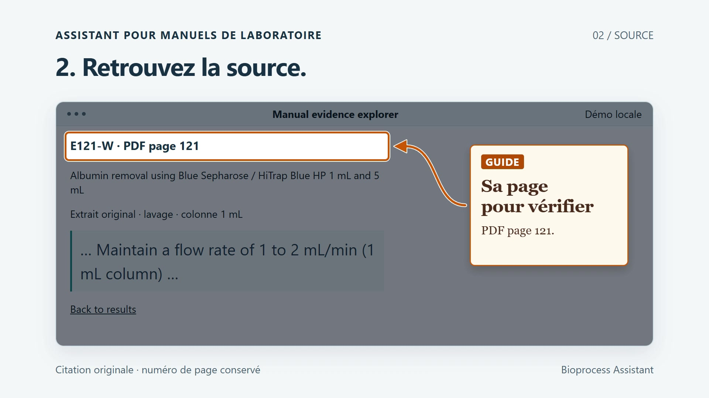

# Bioprocess Troubleshooting Assistant

A demonstrator for **troubleshooting Protein A capture chromatography**. Describe a symptom, retrieve documented possible causes and corrective actions, and inspect their handbook citations.

For example: *“My column pressure is unusually high. What should I check?”* The assistant searches a small curated knowledge graph and displays stored facts selected by the model. Possible causes are documentary hypotheses, not a diagnosis.

The project explores two engineering questions: how to constrain an assistant to traceable knowledge, and how to turn public technical manuals into reviewable, source-linked records. It is a development project, **not a scientifically validated or GxP-qualified system**.

[Watch the demo](#watch-the-demo) · [Architecture](#architecture) · [Run locally](#run-locally) · [Validation](#validation-and-results) · [Documentation](#documentation)

## Watch the demo

[**Explore the interactive walkthrough — no installation**](https://mukunde.github.io/bioprocess-assistant/flowshot/)

Four recorded screens: a MabSelect request, a documented result, its original
Cytiva citation, and clarification when context is missing. Click the highlights
or Next. This is a screenshot walkthrough, separate from the executable local
application. **Published on 1 November 2026.** The README link, all four
screens, citation, clarification, Back, Restart and video navigation were verified
as a signed-out visitor, with no console errors observed.
[Hosting and verification](docs/CYTIVA-FLOWSHOT-HOSTING.md).

[](https://mukunde.github.io/bioprocess-assistant/)

[▶ Watch in your browser (34 seconds)](https://mukunde.github.io/bioprocess-assistant/) · [Download MP4 (2.6 MB)](https://github.com/mukunde/bioprocess-assistant/raw/refs/heads/main/media/cytiva-onboarding-v05/exports/onboarding.mp4) · [Editable sources and credits](media/cytiva-onboarding-v05/README.md)

Follow a guided request, verify its quotation and page, and see how clarification
and quarantine are displayed. Understandable without sound, with French guidance
and the actual English interface. This local demo uses **25 reviewed excerpts**
without an LLM or database; it is separate from the Neo4j troubleshooting chat.

Published on GitHub Pages on 29 October 2026. The README poster → player → Play
path was verified as a signed-out visitor; the video plays in the browser without
a manual download. See [hosting and verification](docs/CYTIVA-VIDEO-HOSTING.md).
The optional MP4 download remains available. The same site now hosts the recorded Flowshot walkthrough; the executable Python application remains local.

## Current status

Status reviewed on 5 November 2026. Latest verified merged checkpoint:
`main` at `73f2517`, including [PR #91](https://github.com/mukunde/bioprocess-assistant/pull/91)
for the staged Protein A/G Sepharose candidate, and [PR #89](https://github.com/mukunde/bioprocess-assistant/pull/89)
for guided MabSelect support in Chainlit, [PR #87](https://github.com/mukunde/bioprocess-assistant/pull/87)
for the reusable local trace demo, [PR #85](https://github.com/mukunde/bioprocess-assistant/pull/85)
for the instrumented UI walkthrough and [PR #83](https://github.com/mukunde/bioprocess-assistant/pull/83)
for corrected local OpenTelemetry tracing, after the acceptance and display work
in [PR #80](https://github.com/mukunde/bioprocess-assistant/pull/80)
and [PR #81](https://github.com/mukunde/bioprocess-assistant/pull/81).

**UA01–UA08 and opt-in registry presentation v02 are merged.** The eight human-reviewed
requests were submitted once each through the baseline registry UI: **8/8 functional
outcomes matched the reviewed references; no critical failure was detected** within
this bounded set. All thirteen cited source pages were opened and checked. The
[compact trial](experiments/cytiva/reviewed-registry-ui-acceptance-v01/README.md)
retains decisions, conditions, quotations, observations and the initial/corrected
checker history. These are new guided-control combinations over known reviewed
sources, not a blinded retrieval, generated-answer or scientific benchmark.

The [separate presentation v02](docs/CYTIVA-REGISTRY-UI-V02.md) addresses the three
recorded usability findings: explicit outside-release refusals for cleaning versus
pressure, one focused clarification action, and a full-original-passage disclosure
for duplicated solvent text. All required sources, reservations and independent
warnings remain available. **27 targeted regressions** passed; structured responses
for the eight combinations and all thirteen source HTML pages match the baseline
exactly. Three browser smoke checks confirm the display changes. This is not a
second prospective acceptance score; the original trial and UI are preserved.

**Optional local OpenTelemetry tracing is merged.** [UI v02 tracing](docs/REGISTRY-TRACING.md)
records allowlisted metadata in a new local JSONL file and/or a loopback OTLP sink.
HTTP requests and registry operations have linked spans; later citation requests
have separate traces. SDK/export failures remain nonblocking, with fixed-phase
diagnostics and bounded cleanup. Request content, quotations and exception details
are excluded. Responses and source HTML retain their existing content.

On merged `73f2517`, the maintained suite ran **1,050 tests** with **1,049
passes and one optional PDFium preview skip**, with zero failures or errors
(620.805 seconds). Both existing freezes verified after the run.

At the earlier `053de44` checkpoint, the maintained suite finished with **1,015 tests:
1,014 passed and one optional PDFium preview skip**, no failures or errors
(562.820 seconds). This includes **24 Chainlit documentary adapter tests**,
**18 local trace-demo tests** and **28 tracing tests**. Both original freezes
were verified again after the run. At the earlier `44ccfcb` checkpoint, the final
confirmation had 990 passed / one skip in 539.314 seconds. Its earlier attempts
retained a Windows loopback 10053 error
and a DOM timeout after a long interruption; both isolated diagnostics passed
before the full confirmation. No code, timeouts or Windows protections were
changed between attempts. The earlier `01f4758` run had 972 passed / one skip
in 1134.479 seconds. The [12-file delivery](docs/validation/REGISTRY-TRACING-PACKAGE.md)
retains the initial review and corrective verification; its earlier `a8272e9`
suite took 529.242 seconds with the same pass/skip counts. These descriptive
suite timings are not a controlled performance comparison. The earlier `2f8ef3d`
checkpoint had 944 passed / one skip; that result remains historical.
Four offline compact-export checks cover integrity and LF/CRLF
portability. Both original freezes remain valid: v03 (36 pins), MabSelect (52 pins).
The registry UIs and Chainlit adapter remain outside these historical closures; none is a new freeze.

The original registry UI stays on explicit port 8784; presentation v02 is a separate
opt-in module on 8785. Both require an existing approved local authority root.
The private verification store remains generation 1 with zero withdrawals and is
not shipped. Fresh clones still need their own reviewed activation. Preview 8783,
Windows launchers, default graph chat and published video/Flowshot captures are unchanged;
this does not publish a live executable demo.

**The instrumented UI walkthrough is merged.** [Four known scenarios](docs/validation/REGISTRY-TRACING-UI-WALKTHROUGH.md)
passed on disposable authority: sourced support, clarification, pressure abstention
and withdrawal. Supplemental HTTP checks verified nine source pages; 37 local
spans retained metadata-only content and correct parent links. The deliberately
unavailable OTLP collector did not block responses or JSONL export. The favicon
404 and one automation wait limitation remain recorded. This is known-corpus
diagnostic evidence, not independent acceptance or scientific validation.

**The reusable local request → source → trace demo is merged in
[PR #87](https://github.com/mukunde/bioprocess-assistant/pull/87).** The separate
`demo.registry_demo` entry point on port 8786 reuses UI v02 and adds a read-only
session summary. It accepts only allowlisted metadata, labels root-only HTTP
rejections without inventing registry calls, and contains optional SDK failures.
Refreshing the summary neither writes traces nor flushes exporters. Missing or
invalid authority is refused; nothing is automatically approved or activated.
See the [operator guide](docs/REGISTRY-TRACE-DEMO.md) and
[corrective review](docs/validation/REGISTRY-TRACE-DEMO-CORRECTIONS.md).
Eighteen demo tests cover the new behavior. A focused browser smoke followed a
request, E167-P citation and summary on disposable synthetic authority: five HTTP
requests and seven spans, with no new spans on summary refresh. It preceded the
error-path fixes, which have HTTP/CLI regressions; it is not a new acceptance
trial or fresh-install/second-PC validation.

**The guided MabSelect documentary mode in Chainlit is merged in
[PR #89](https://github.com/mukunde/bioprocess-assistant/pull/89).** Explicit
`BIOPROCESS_MODE=mabselect` selects guided product/context controls backed by an
existing approved registry. It displays the submitted scope, separate conditional
options, precautions and reservations, with current-authority citation views,
one focused clarification and scoped abstention. Withdrawn support supplies no
new quotation; independent support remains available. Startup retry, strict
control validation and stale-result guards have regression coverage. The default
graph route remains unchanged; documentary free text never calls a model.
See the [operator guide](docs/CHAINLIT-MABSELECT.md) and
[corrections/re-review](docs/validation/CHAINLIT-MABSELECT-CORRECTIONS.md).
The candidate passed **30 focused tests** (24 adapter + six legacy app tests).
Browser checks on disposable synthetic authority covered combined clarification,
SuRe LX partial support/pressure abstention and the E167-S source/provenance view.
These are known-source conformance checks, not a new independent acceptance score.
Generic shell presentation and sign-in diagnostics remain documented. Existing
messages are snapshots; withdrawals cannot erase text already displayed.

**The Protein A/G Sepharose backpressure candidate is merged and staged.**
The explicit `BIOPROCESS_MODE=sepharose_candidate` workbench serves scoped
Q01–Q04 and Q09 evidence for preview. It preserves separate cleaning options and
their precautions, asks for missing product or context, and abstains from giving
an unsupported numerical pressure limit. In withdrawal simulations, eligible
clarification remains available when independent support is held. The candidate
remains non-activated and uses separate local artifacts.
See the [operator guide](docs/CHAINLIT-SEPHAROSE-CANDIDATE.md) and the
[corrected review](docs/validation/SEPHAROSE-CANDIDATE-CORRECTIONS.md).

**Next priority is a focused acceptance check of the staged candidate.**
Define a small set of new guided requests with expected outcomes before running
them in the explicit Chainlit preview on disposable candidate data. Cover
product boundaries, clarification during a simulated withdrawal, complete
citations and precautions, and abstention on numerical pressure. Record outcomes
and gaps for a separate activation decision.

Earlier registry-UI checkpoint (3 November 2026):
`main` at `c230f14`, including [PR #78](https://github.com/mukunde/bioprocess-assistant/pull/78).
The **opt-in MabSelect registry UI** is merged: an explicit server-side authority
root supplies typed responses and current-authority citation views. It handles
clarification, scoped abstention and withdrawn support without preview fallback;
independent support and essential warnings remain available. A 15-second request/
body deadline allows manual retry and rejects late results. Unexpected citation
failures return controlled 503 responses; truly unknown sources remain 404 under
verified authority. See the [usage guide](docs/CYTIVA-REGISTRY-UI.md) and
[nine-file delivery/review package](docs/validation/MABSELECT-REGISTRY-UI-PACKAGE.md).

At that checkpoint, the complete suite on merged `main` passed **914 tests executed: 913 passed,
one optional PDFium preview skip**, with no failures/errors. It includes **18 UI
HTTP/DOM tests**, six added for failure containment and timeout/retry. Normal
responses and source pages were checked in the browser; withdrawal/corruption/
request-stall tests use disposable or controlled fixtures. Both original freezes
remain valid and unchanged: v03 (36 pins), MabSelect (52 pins). This UI is outside
those historical freeze closures; these are known-case conformance results, not
an independent answer-quality or scientific benchmark.

The private verification store is still active at generation 1 with zero
withdrawals and is not shipped in Git. Fresh clones retain the staged candidate
and require their own reviewed local activation. The new UI on port 8784 is an
explicit opt-in; the original preview on 8783, Windows launchers, recorded tours
and legacy chat remain separate and unchanged. No public executable deployment
or automatic activation is introduced.

Earlier local activation checkpoint (2 November 2026): `main` at `59b5aee`, including
[PR #76](https://github.com/mukunde/bioprocess-assistant/pull/76). The approved
**local activation of `mabselect-local-v02`** is recorded in the merged eight-file
[audit package](experiments/cytiva/mabselect-local-activation-v02/README.md).
LA01–LA08 and the initial empty withdrawal inventory were approved explicitly.
The private store on the verification machine has one durable head (generation 1),
withdrawal version 1 and zero events. It covers five bundle purposes, thirteen
sources and five scoped reviews, with conditions and reservations unchanged.

SX01–SX06 passed through active evaluation: **25 citation occurrences and all
13 source views verified**. The activation's 32 lifecycle tests passed in disposable
roots. On merged `main`, **896 tests executed: 895 passed, one optional PDFium
preview skip**. Both original freezes remain valid: v03 (36 pins), MabSelect
(52 pins). These are known-case integrity/conformance results, not independent
answer-quality or scientific validation.

**Local activation is not deployment:** the private store is ignored and is not
shipped in Git. A fresh clone still has the staged candidate and cannot serve it
without its own reviewed local activation. At that checkpoint the UI, launcher
and legacy chat were unconnected to the active registry. The merged package records the
completed local run; it does not activate anything on another machine. See the
[activation report and recovery limits](docs/validation/MABSELECT-REGISTRY-V02-LOCAL-ACTIVATION.md).

Earlier registry implementation checkpoint (2 November 2026): `main` at `37a44eb`, including
[PR #74](https://github.com/mukunde/bioprocess-assistant/pull/74). The local
release/withdrawal registry is merged around the unchanged frozen handoff.
Candidate **`mabselect-local-v02` remains staged, not activated**: five bundle
purposes, thirteen source objects, five scoped reviews and 56 bound dependencies.
It checks authority and citations per operation, applies scoped withdrawals,
rejects restored old active pointers and distinguishes backend failure from
authority drift. Historical validation is deduplicated within each operation.
The original v01 artifacts/results remain historical evidence.

On merged `main`, **896 tests executed: 895 passed, one optional PDFium preview
skip**. Both freezes verified with their original digests: v03 (36 pins) and
MabSelect (52 pins). The v02 SX01–SX06 replay and inventory-only reproduction
passed before merge; these are known-case conformance checks, not independent
answer-quality or scientific validation. At that checkpoint, no active pointer or activation journal
existed, and the registry was not connected to the UI or legacy chat. See the
[registry correction review and limits](docs/validation/MABSELECT-LOCAL-REGISTRY-REVIEW-FIXES.md).

Earlier freeze checkpoint (2 November 2026): `main` at `e2b8531`, including
[PR #72](https://github.com/mukunde/bioprocess-assistant/pull/72). The corrected
MabSelect handoff now has a separate **52-file local freeze**. SX01–SX06 replay
with complete responses/citations identical to the retained output, including
from an inventory-only copy using `python -S`. The full merged-main verification
finished with **864 tests executed: 863 passed, one optional PDFium preview skip**.
The initial HTTP-boundary test's Windows `10053` interruption is preserved;
the three HTTP tests and a second full run passed without code/security changes.
Both freezes remain valid: v03 (36 pins) and MabSelect (52 pins). See the
[freeze and replay package](docs/validation/MABSELECT-DOCUMENTARY-FREEZE-PACKAGE.md).
At that checkpoint the handoff was reproducible but **serving was not activated**; no independent
answer-quality or scientific validation follows from these checks.

Earlier handoff checkpoint (2 November 2026): `main` at `ada012b`, including
[PR #70](https://github.com/mukunde/bioprocess-assistant/pull/70). The corrected
MabSelect documentary handoff, accepted contract/decisions, machine schemas and
local preview are merged. The complete suite on that baseline finished with
**854 tests executed: 853 passed, one optional PDFium preview skip**. An initial
Windows HTTP interruption (`10053`) in an older demo test was preserved; the
isolated test module and a second complete run passed without code or security
changes. Frozen v03 and its 36 pins remain valid. See the
[handoff implementation and review](docs/validation/MABSELECT-DOCUMENTARY-HANDOFF.md)
and [24-file package](docs/validation/MABSELECT-DOCUMENTARY-HANDOFF-PACKAGE.md).
These are regression/integrity checks, not independent answer-quality validation.

Previous merged application checkpoint (2 November 2026): `main` at `4d2809b`, including
[PR #68](https://github.com/mukunde/bioprocess-assistant/pull/68). The separate
MabSelect cleaning journey, portable approval checks, DOM/API regressions and
suite repairs are merged. On the exact merged files, **830 tests executed:
829 passed, one optional PDFium preview skip, no failures or errors**.
Frozen v03 and its 36 pins remain valid. These are regression and integrity
checks, not independent retrieval, answer-quality or scientific validation.
See the [combined package](docs/validation/MABSELECT-CLEANING-PACKAGE.md) and
[suite repair analysis](docs/validation/MABSELECT-SUITE-REPAIR.md).

Publication checkpoint (1 November 2026): `main` at `5decd53`, with the wide
Flowshot package ([PR #65](https://github.com/mukunde/bioprocess-assistant/pull/65))
and Pages integration ([PR #66](https://github.com/mukunde/bioprocess-assistant/pull/66))
merged. [Deployment](https://github.com/mukunde/bioprocess-assistant/actions/runs/41350245456)
succeeded and the public README-to-walkthrough route was verified. Three targeted
publication tests pass. This is media delivery evidence, not a new application or
answer-quality benchmark. The captured MabSelect implementation was separate at that publication checkpoint and has since merged in PR #68.

Earlier application verification checkpoint (31 October 2026): `main` at
`7d6b9c2`, including the bounded backpressure journey
([PR #62](https://github.com/mukunde/bioprocess-assistant/pull/62)) and historical
documentation-binding repair
([PR #63](https://github.com/mukunde/bioprocess-assistant/pull/63)). The complete
suite on the exact merged files passed **799 tests with one optional-dependency
skip (800 executed)**; 20 affected-package tests passed again after merge.
These are regression checks, not an independent answer-quality result.

The historical published-video checkpoint is `main`
at `497f0f1`: the approved v05 package ([PR #58](https://github.com/mukunde/bioprocess-assistant/pull/58)),
README integration ([PR #59](https://github.com/mukunde/bioprocess-assistant/pull/59))
and the GitHub Pages player ([PR #60](https://github.com/mukunde/bioprocess-assistant/pull/60))
are merged. The [manual deployment](https://github.com/mukunde/bioprocess-assistant/actions/runs/40862970741)
succeeded; live playback is a media-delivery check, not a new answer-quality result.

Historical Windows setup checkpoint (27 October 2026): `main` at `4b2bfa5`, including
[PR #51](https://github.com/mukunde/bioprocess-assistant/pull/51) (v03 runtime freeze),
[PR #52](https://github.com/mukunde/bioprocess-assistant/pull/52) (guided demo and usability fixes)
and [PR #53](https://github.com/mukunde/bioprocess-assistant/pull/53) (Windows launcher),
followed by [PR #55](https://github.com/mukunde/bioprocess-assistant/pull/55)
(isolated Windows installation and verified tokenizer setup).
The complete maintained suite passed **790/790 tests** on that merged baseline,
with no skipped tests or external connection attempts.

The merged v02/FV trial preserves all twelve human approvals and its completed
one-pass comparison. The structured arm passes
**22/24**, free text **17/24** (EN 10/12, FR 7/12), and **7/12 bilingual pairs**
pass. Acceptance is not met. FV06 fails both arms only on a shared coverage flag;
its individual unit states match the reference. See the
[compact FV package](experiments/cytiva/free-text-v02-comparison-v01/README.md).
The failures informed corrected v03; they were not rescored. No experimental
interpreter is the legacy chat default.

**Merged and demonstrable locally:** corrected v03 is frozen with 36 pinned files.
The free guided demo uses 25 reviewed excerpts to display documentary support,
source quotations, clarification, missing evidence and quarantine without a model
or Neo4j. Usability corrections and a Windows launcher with dependency/cache and
freeze checks are merged. The separate Windows installer is also merged: it creates
an isolated environment, installs 12 hash-locked dependencies and prepares the
verified tokenizer cache. Setup and the walkthrough passed in a fresh clone on
the same PC; validation on a second physical machine remains pending. See
[the demo-first guide](docs/DEMO-FIRST.md).

**Also merged:** a [bounded backpressure journey](docs/validation/CYTIVA-TROUBLESHOOTING-DEMO.md)
for Protein A/G Sepharose, separate from frozen v03. Select an exact product and
a deposit context to explore the original cleaning passages on PDF pages 166–167.
Unknown context leads to clarification; hydrophobic cleaning routes stay
alternative, with their quantities and pressure precaution. MabSelect remains
outside this first Protein A/G entry and now has its own separate entry below. The documentary source pool contains 17
reviewed cleaning excerpts; each response uses its own reviewed source bundle.
This path uses no model, API or database and does not establish a cause, treatment
suitability or authorization to reuse a medium. The four-scenario browser check
and usability fixes were agent checks, not new human scientific approval.

| Component | Status and scope |
|---|---|
| Troubleshooting chat | Implemented: six curated Protein A symptoms, English full-text Neo4j retrieval, Anthropic tool use and application-controlled rendering |
| French and English questions | Agent selects English search phrases; headings/refusals are localized and technical graph facts remain in English |
| Local PDF ingestion | Experimental Docling Graph/Ollama route with structural chunking, localization and review UI; separate optional evidence publication |
| Reviewed manual extraction | Merged development example: 33 statements reviewed on pages 100–102, with 14 reservations; not served by the chatbot |
| Conversion and chunking | Selected page 77/88/104/152–153 reviews and repairs are merged; three ambiguous rows remain quarantined on 152–153 |
| Passage retrieval | Merged BM25/atomic assembly experiments; frozen v03b, v04 and v05 gates remain blocked and none is the chat default |
| Structured request control | Merged offline control. S01-S12: all 24 EN/FR submissions and all 12 paired scenarios pass reviewed context/diagnostic criteria; known-corpus diagnostic evidence only |
| Free-text interface and local demo | v01/v02, reviewed FT/FV trials, corrected opt-in v03, its runtime freeze, corrected guided/text demo, Windows installer and launcher merged. Same-PC fresh-clone setup verified; second-machine validation pending. Historical gates remain blocked |
| Bounded backpressure journey | Merged: deterministic Protein A/G Sepharose product/context selection, clarification, separate alternatives and original citations; independent of frozen v03. MabSelect is outside scope |
| MabSelect cleaning journey | Merged in PR #68: exact-product/context controls, source-linked general/restricted alternatives, warnings and no-recipe clarification; portable approval verification and DOM/API mutation checks; separate from v03 and the legacy chat |
| Reviewed documentary handoff | Implementation merged in PR #70; separate 52-file freeze and accepted-case replay merged in PR #72. Typed task-bound support, citations/reservations, clarification, scoped abstention and contained failures. Preview plus separately activated private registry/UI; fresh clones staged. PR #89 adds an explicit guided Chainlit documentary mode; legacy graph migration remains pending |
| Local release/withdrawal registry | Implementation merged in PR #74; approved private v02 activation record merged in PR #76. Empty initial withdrawal inventory; Git ships staged data, no automatic activation in a fresh clone; local single-writer trust boundary |
| Opt-in MabSelect registry UI | Baseline merged in PR #78; reviewed UA01–UA08 trial in PR #80 (8/8 bounded functional outcomes). Separate presentation v02 in PR #81: three display fixes and 27 regressions, unchanged structured responses/source pages; private authority required |
| Observability and evaluation extensions | Minimal metadata-only local tracing merged in PR #83; PR #85 records four known UI scenarios, nine supplemental source checks and 37 spans. PR #87 adds the reusable local metadata summary/demo; PR #89 reuses optional registry-operation tracing in Chainlit. Broader instrumentation, model usage/cost accounting, Ragas and Promptfoo pending. LightRAG is a comparison candidate and KAG remains conditional |

The default graph chat model is configured as `claude-sonnet-4-6` in [agent.py](agent.py). The separate reviewed extraction used GPT-6.1 Sol through a subscription interface; that subscription does not fund the chatbot's API calls.

**MabSelect is also merged as a separate local entry:** choose **MabSelect · cleaning guidance**.
Exact plain MabSelect, SuRe and SuRe LX retain their reviewed conditions and
product-specific restrictions. General formulations and stronger-alkali blocks
remain distinct; detergent/solvent alternatives keep their warning and citations.
Unknown or conflicting inputs require clarification. This extends the local
model-free demo, not the legacy Neo4j corpus. The [design and scope](docs/technical/MABSELECT-CLEANING-JOURNEY-V01.md)
and [implementation checks](docs/validation/MABSELECT-CLEANING-DEMO.md) preserve
original approvals and reservations. The separate documentary handoff now has
the PR #72 freeze described below; the original entry and v03 remain unchanged.

**The documentary handoff is now merged too:** a separate local preview reuses
that selector and transfers complete reviewed bundles to a typed response service.
It preserves product/context ownership, original quantities and immediate washes,
citations and scoped reservations. Missing context asks for clarification;
unsupported pressure/hold-time values are declined only within the selected
excerpts. Unexpected failures yield `unavailable` without suppressing independent
tasks. This preview is not an activated serving release or a new hosted demo.
Its [separate freeze](experiments/cytiva/mabselect-handoff-freeze-v01/README.md)
pins the code/schema/source/review closure and replays the six accepted cases;
it does not replace v03 or create an active release/withdrawal registry.

## Architecture


The diagram's observability roadmap extends beyond the implemented local registry
UI slice. PR #89 also reuses optional registry-operation tracing in the Chainlit
documentary mode; tracing of model-backed graph chat, extraction and judge calls
remains pending. The diagram predates that opt-in mode; the loop below describes
the default graph chat.

**Solid arrows** show implemented paths. **Dashed coral arrows** show planned connections. Read ingestion and storage at the top, then the serving loop below:

1. Chainlit sends the question to the agent.
2. The agent calls `query_graph` with an English symptom phrase. Neo4j searches the English symptom index and traverses `Symptom → INDICATES → Cause → RESOLVED_BY → Action` using parameterized Cypher.
3. The model selects retrieved result IDs. Application code validates the selection and renders stored facts and citations. Unsupported selections, missing knowledge and operational errors have separate handling.

Free-form model advice is not displayed. This constrains generation, but does not guarantee relevant retrieval or scientifically correct source material. A Lucene score measures lexical relevance, not diagnostic confidence.

Ingestion has two separate routes: **Docling → Docling Graph + local Ollama → review**, and the completed **Docling → GPT-6.1 Sol → checks and human review** experiment. Local chunking follows document structure and hierarchy, then token budgets; the reviewed three-page experiment used its full input without automatic chunking. Neither extraction route currently feeds the default graph chat; the explicit documentary mode uses separately reviewed cleaning excerpts.

[Full-size SVG](docs/architecture/architecture-detailed.svg) · [Diagram notes and logo sources](docs/architecture/README.md) · [Grounding decision](docs/ADR-001-knowledge-graph-grounding.md)

## Run locally

### Local Cytiva demo (Windows)

For a fresh Windows x64 clone, install CPython **3.13.0** separately, then run
`.\Install-CytivaDemo.ps1` to create `.venv-demo`, install hash-locked dependencies
and prepare the verified tokenizer cache. The installer is merged; see the
[setup guide](docs/DEMO-FIRST.md#install-from-a-fresh-windows-clone)
for prerequisites and offline installation.

The Windows launcher finds a compatible local Python environment, checks the
frozen dependency versions and offline tokenizer, verifies v03 and starts the demo.
From the repository root:

```powershell
.\Install-CytivaDemo.ps1
.\Start-CytivaDemo.ps1 -CheckOnly
.\Start-CytivaDemo.ps1
```

Open [localhost:8766](http://127.0.0.1:8766/). Start with washing flow, then add
maximum pressure and equilibration flow to inspect partial service. It uses no
model or database. The explicit installer downloads packages and tokenizer data;
the launcher and running demo do not install or download anything. The
[demo guide](docs/DEMO-FIRST.md) covers `-CheckOnly`, `-PythonPath`, `-Port`, the
walkthrough and prerequisites for another machine. Ctrl+C stops the local server.

For the Protein A/G journey, choose **Troubleshooting · rising backpressure**, or open
[the direct local link](http://127.0.0.1:8766/#troubleshooting-controls). Try an
unspecified product, Protein A Sepharose with hydrophobic context, then MabSelect;
open a citation to inspect the original product scope and warning. This journey
is separate from the guided/text v03 route shown in the existing video. See
[scope and verification](docs/validation/CYTIVA-TROUBLESHOOTING-DEMO.md).

For MabSelect, choose **MabSelect · cleaning guidance** or open
[the local entry](http://127.0.0.1:8766/#mabselect-controls). Try an unspecified
variant, exact plain MabSelect with precipitated substances, SuRe with that same
context, then SuRe LX with hydrophobic context. Check the separate alternatives,
E167-W warning and citations; unknown/mixed context should request clarification,
not select a recipe. This is documentary support, not a diagnosis.

To inspect the new documentary handoff in the prepared demo environment:

```powershell
.\.venv-demo\Scripts\python.exe -m demo.documentary_preview --port 8783
```

Open [localhost:8783](http://127.0.0.1:8783/). Try an unknown MabSelect variant,
then SuRe LX with hydrophobic context and the numerical-pressure checkbox.
Inspect the task attribution, scoped abstention and original E167-W citation.
The preview needs no LLM, database, PDF or new download and does not change v03.
Its default Python service remains inactive unless explicitly opened in preview
mode. The published video/Flowshot captures are unchanged and predate this handoff.

To use the separate **merged registry-backed UI**, provide an existing approved
local authority root explicitly. On the verification checkout:

```powershell
.\.venv-demo\Scripts\python.exe -m demo.registry_ui --registry-root .local-tools\mabselect-registry-v02-runtime --port 8784
```

Open [localhost:8784](http://127.0.0.1:8784/). Citation pages use current withdrawal
authority; missing or invalid authority returns unavailable, with no staging
fallback. This command never creates/activates the root. A fresh clone does not
contain the private store; use its own separately reviewed activation. See the
[registry UI walkthrough](docs/CYTIVA-REGISTRY-UI.md) for setup, clarification,
abstention, recovery and test commands. The original preview above remains available.

For the merged **presentation v02** with clearer refusals and less repetition,
use the same approved authority through its separate entry point:

```powershell
.\.venv-demo\Scripts\python.exe -m demo.registry_ui_v02 --registry-root .local-tools\mabselect-registry-v02-runtime --port 8785
```

Open [localhost:8785](http://127.0.0.1:8785/). The command does not create or activate
a registry. [V02 usage and limits](docs/CYTIVA-REGISTRY-UI-V02.md) explain the
clarification/source disclosures; the baseline 8784 UI remains available.

For the merged **request → source → trace demo**, prepare a separate observation
environment as described in the [short guide](docs/REGISTRY-TRACE-DEMO.md);
do not install tracing dependencies into the frozen `.venv-demo`. Then run:

```powershell
.\.venv-observe\Scripts\python.exe -m demo.registry_demo --registry-root "C:\path\to\approved-registry"
```

Open [localhost:8786](http://127.0.0.1:8786/), make a guided request, open its
citation, then follow **View the local trace summary**. No collector is needed.
The command checks existing authority read-only and writes a new ignored trace
session outside the registry; it does not create approvals or activate a store.

Verify the new freeze or replay its accepted cases with the recorded CPython
3.13.0 environment; no site packages, PDF, tokenizer cache or network is required:

```powershell
.\.venv-demo\Scripts\python.exe -S -m experiments.cytiva.mabselect_handoff_freeze --environment
.\.venv-demo\Scripts\python.exe -S -m experiments.cytiva.mabselect_handoff_freeze --replay
```

The [frozen method and results](experiments/cytiva/mabselect-handoff-freeze-v01/README.md)
document exact hashes, full saved responses and no-overwrite output handling.

### Guided MabSelect in Chainlit — no model

Use an existing development/verification environment with Chainlit installed,
separate from both frozen runtimes. With local login credentials and
`CHAINLIT_AUTH_SECRET` configured as described in the
[operator guide](docs/CHAINLIT-MABSELECT.md):

```powershell
$env:BIOPROCESS_MODE = 'mabselect'
$env:MABSELECT_REGISTRY_ROOT = 'C:\path\to\your\approved-registry'
.\.venv\Scripts\python.exe -m chainlit run app.py --host 127.0.0.1 --port 8787
```

Replace the Python path with your prepared development/verification environment
if needed. Open [localhost:8787](http://127.0.0.1:8787/), sign in, choose Settings
and press **Find documented guidance**. No model key or Neo4j connection is needed
for this route. The root is server configuration, not a browser input; the command
never prepares or activates authority. Fresh clones do not include the private
store. Optional metadata tracing uses `MABSELECT_TRACE_FILE`; its operation spans
are not asserted compatible with the port-8786 HTTP trace-summary schema.

To use the existing graph route instead, stop the server and remove
`BIOPROCESS_MODE` or set it to `graph` before relaunching. Unknown mode values
refuse documentary service rather than silently calling the agent.

### Existing Chainlit/Neo4j graph chat

The reference workstation uses **Windows, Python 3.13 and Docker Desktop**. The application Dockerfile targets Python 3.11. These are documented configurations, not a cross-platform certification. PDF ingestion uses a separate optional environment.

The commands below use PowerShell and run the application on the host, with Neo4j in Docker. Install Git, Python 3.13 and Docker Desktop first; start Docker Desktop before starting the database.

### 1. Install the application

```powershell
git clone https://github.com/mukunde/bioprocess-assistant.git
cd bioprocess-assistant
py -3.13 -m venv .venv
.\.venv\Scripts\python.exe -m pip install -r requirements.txt
if (-not (Test-Path .env)) { Copy-Item .env.example .env }
```

### 2. Configure local services and authentication

Edit the ignored `.env`. Its template still contains Aura placeholders: replace the four database settings with the local values below and choose a password **before the first database start**.

```dotenv
NEO4J_URI=bolt://127.0.0.1:7687
NEO4J_USERNAME=neo4j
NEO4J_PASSWORD=replace_with_a_local_password
NEO4J_DATABASE=neo4j
```

For default graph-chat requests, set `ANTHROPIC_API_KEY`. Generate the Chainlit signing secret:

```powershell
.\.venv\Scripts\chainlit.exe create-secret
```

Copy the generated value into `CHAINLIT_AUTH_SECRET` in `.env`, then set `DEMO_USERNAME` and `DEMO_PASSWORD` for the login screen. Replace all placeholders; keep credentials in the ignored `.env`. Offline regressions need no API key or running Neo4j.

### 3. Start Neo4j and load the seed

```powershell
docker compose -f compose.neo4j.yaml up -d --wait
.\.venv\Scripts\python.exe scripts/load_graph.py
```

The loader creates constraints and the English full-text index, waits for indexes and applies seed updates transactionally while preserving unrelated records. Changing `.env` later does not change an existing database password. Persistent Docker storage and connection troubleshooting are covered in the [local Neo4j guide](docs/LOCAL-NEO4J.md).

### 4. Start the interface

```powershell
.\.venv\Scripts\chainlit.exe run app.py -w
```

Open [localhost:8000](http://localhost:8000) and log in with the credentials you configured. Try *“My capture yield has dropped”* or *“La pression de ma colonne est anormalement élevée.”* The settings slider adjusts the lexical threshold; lowering it can admit weak matches.

Stop the database when finished:

```powershell
docker compose -f compose.neo4j.yaml stop
```

For an application container, configure a database address reachable **from that container**: `127.0.0.1` would refer to the application container itself. The host-based setup above avoids that mismatch. The [Dockerfile](Dockerfile) is available; hosted infrastructure and credentials require their own configuration.

## Validation and results

Install the additional test dependencies into the application environment:

```powershell
.\.venv\Scripts\python.exe -m pip install -r eval/requirements.txt -r requirements-structured.txt
npm ci --prefix tests/ui --ignore-scripts --no-audit --no-fund
.\.venv\Scripts\python.exe scripts/run_tests.py --temp-root "$env:LOCALAPPDATA\Temp"
```

The [current suite notes](tests/README.md) explain the maintained entry point and preservation of frozen historical fixtures.

These tests mock external model/database calls; some use loopback HTTP servers
and Windows asynchronous sockets. They need no paid API or external service.
The latest complete run on merged `2f8ef3d` passed **944 tests with one optional
skip (945 executed)**. Earlier checkpoints remain historical: **913 passed / one
skip** for the PR #78 UI, **863 passed / one skip** on `e2b8531`, **853 passed / one
skip** on `ada012b`, and **829 passed / one skip** on `4d2809b`.
These checks used the maintained verification environment, offline cache, locked
test-only Node/jsdom dependencies and a short temporary root. The skip concerns
the optional PDFium preview dependency. The runner keeps nested Windows fixtures
out of deep checkout paths; DOM HTTP waits are bounded and the subprocess ceiling
remains 40 seconds. Three historical manifests refresh documentation support
hashes only. The first failed run and the uncertainty about its DOM timeout
remain recorded in the [repair analysis](docs/validation/MABSELECT-SUITE-REPAIR.md).
The earlier **799/one skip** and **790/790** checkpoints above remain historical.
None is clean-OS certification or an answer-quality measurement.
The separate demo setup also passed in a fresh clone on the same PC. Its twelve
dependencies and wheel hashes are in `demo/requirements-windows.lock`; its installer
prepares the public tokenizer asset with the frozen hash. Other structured runtime
workflows use `requirements-structured.txt` and may need their own local cache setup.

The merged structured export can be verified with only the standard library,
without PDFs, tokenizer assets, credentials, models or private run files:

```powershell
python -S -m experiments.cytiva.verify_structured_reviewed_package
python -S -m unittest tests.test_structured_reviewed_package -v
```

These commands inspect saved evidence; they never rerun S01-S12. The merged
EN/FR runtime has IF01–IF14 conformance and regression checks. The merged FV
package adds static freeze/review/export guards; passing tests or reviewed forms
does not establish general language understanding or generated-answer quality.

| Development evidence | What it establishes | Limits |
|---|---|---|
| [Reviewed extraction, pages 100–102](experiments/cytiva/reviewed-r2/README.md) | 33 corrected statements: 19 validated and 14 validated with reservations; decisions and hashes preserved | Documentary review only; no exhaustive recall, scientific approval or publication |
| [Page 77 review](experiments/cytiva/reviewed-page-077/README.md) and [page 88 review](experiments/cytiva/reviewed-page-088/README.md) | Species/header scope, pH, remarks, reconstructed product cells and five notes reviewed with reservations | Original conversion defects remain documented; targeted repairs do not fix Docling generally; table-only retrieval may omit adjacent context |
| [Figure 104 review](experiments/cytiva/reviewed-page-104/README.md) | Image/caption, five paths, alternative role, applicability and K0/K800 text conservation reviewed | Human interpretation is not native extracted graph edges; automatic text-only diagram semantics remain quarantined |
| [Pages 152–153 annotated review](experiments/cytiva/reviewed-pages-152-153-v2/README.md) | Continued table, repaired HiTrap/HiScreen row and reviewed note annotations retained in new chunks | Three ambiguous rows remain physically separated in quarantine; no complete property-cell or production retrieval validation |
| [Cleaning retrieval](docs/experiments/cytiva-retrieval-depth-results.md) | Six-hit candidate supplies all required sources for Q01–Q10 and N01–N08 in both languages, under a 2,048-token context cap | Known development questions; additional context is not proven more precise; no generated answers evaluated |
| [Contaminant context ablation](docs/experiments/cytiva-contaminants-context-results.md) | On C01–C10, section context raises complete evidence from 6/10 to 10/10 in both languages; combined vocabulary/context also reaches 10/10 | Tuned after inspecting failures; no independent generalization or answer-quality result; E118-I and E121-EQ remain pending and excluded |
| [Frozen v03b / V01-V12](experiments/cytiva/reviewed-v03b-evaluation/README.md) | Twelve reviewed references; 24 saved contexts; 6/12 intents have complete evidence in both languages, but only V02/V05/V09 also respect explicit scope | Merged; acceptance gate blocked. Source omissions and unrequested phases remain visible; no generated answers evaluated |
| [v04 development A-D](experiments/cytiva/compositional-navigation-v04-results/README.md) | Composes requests and handles bounded negations; final known-case coverage V12/12, H10/10, C10/10 in both languages; no unrequested or outside-acceptable V context | Merged development result after inspecting failures; no independent validation or default activation. One optional V03 seed still exceeds the six-seed cap |
| [Frozen v04 / W01-W12](experiments/cytiva/reviewed-v04-evaluation/README.md) | Merged review and 24 saved contexts: 8/12 intents evidence-complete in both languages, but only W10/W11 satisfy completeness, explicit scope and diagnostics | Gate blocked: 13/24 explicit scope failures and 2/24 diagnostic failures; no generated answers evaluated |
| [v05 development A-B](experiments/cytiva/polarity-navigation-v05-results/README.md) | Merged known-case coverage W12/12, V12/12, H10/10, C10/10; both attempts retained, including intermediate C02 failure | Tuned after inspecting W failures; not prospective validation or default activation; absent H/C scope annotations remain unavailable |
| [Frozen v05 / X01-X12](experiments/cytiva/reviewed-v05-evaluation/README.md) | Merged compact export: 12 reviewed intents and 24 contexts; EN 8/12, FR 7/12 complete; only X02/X05/X09 satisfy all scope/diagnostic criteria in both languages | Gate blocked: 9/24 explicit scope failures and 6/24 diagnostic failures; task ownership, nested negation and routing/lexical disagreement remain unresolved |
| [Structured S01-S12 trial](experiments/cytiva/reviewed-structured-control/README.md) | Merged: 12 human-reviewed scenarios, all 24 saved submissions pass context/diagnostics; no EN/FR semantic divergence; 348–1,504 context tokens | Structured intent control on known sources/code, not free-text or generated-answer validation; E118-I/E121-EQ remain excluded |
| [Free-text design and grouped examples](docs/technical/FREE-TEXT-MACHINE-DESIGN-V01.md) | CP/FI/MC decisions, GR01–GR04 review and deterministic EN/FR runtime merged | Bounded offline interface; no default chat activation or source approval |
| [Frozen v01 / FT01-FT12](experiments/cytiva/free-text-comparison-v01/README.md) | Merged: S 24/24, F0 12/24 observations and 4/12 bilingual pairs | Acceptance blocked; inspected FT cases became v02 development regressions |
| [Opt-in v02](docs/technical/FREE-TEXT-CANDIDATE-V02.md) | Merged candidate; 57 targeted checks and FT development regressions pass | Does not replace v01 or demonstrate independent performance |
| [Frozen v02 / FV01-FV12](experiments/cytiva/free-text-v02-comparison-v01/README.md) | Merged reviewed delivery: S 22/24, F0 17/24, 7/12 pairs; 48 outcomes retained; 1,674-token maximum | Gate blocked by item identity, FR phase association and FV06 shared-flag/reference mismatch. No reference amendment or rescoring |
| [Corrected v03](docs/technical/FREE-TEXT-CANDIDATE-V03-REVIEW-FIXES.md) | Merged: versioned coverage, buffer occurrences and French phase-origin fixes; 76 v03 checks pass; [runtime freeze](experiments/cytiva/free-text-v03-freeze-v01/README.md) pins 36 files | Known development regressions and runtime integrity, not a new prospective score or legacy chat activation |
| [Guided demo and Windows setup](docs/DEMO-FIRST.md) | Merged: request-to-source walkthrough, usability corrections, isolated hash-locked installation and launcher checks; seven browser/HTTP scenarios and five exact displayed quotations checked | Same-PC fresh-clone evidence; second-machine/clean-OS validation pending. 25-excerpt scope; no generated advice or whole-manual coverage |
| [Bounded backpressure journey](docs/validation/CYTIVA-TROUBLESHOOTING-DEMO.md) | Merged: four agent browser scenarios, 17 journey/demo regressions and scoped cleaning-review reuse; exact source quotations and pressure warning retained | Product/context exploration, not diagnosis; no independent retrieval/answer benchmark or operational approval. MabSelect outside scope; frozen v03 unchanged |
| [MabSelect and suite repairs](docs/validation/MABSELECT-CLEANING-PACKAGE.md) | Merged in PR #68: MS01–MS08/C1–C4 design approval replay, MC01–MC12, DOM/API control and mutation tests; merged-main suite 829 passed / one optional skip | Known reviewed sources and code; no new runtime freeze, source approval or independent answer-quality result; no legacy chat enrichment |
| [Corrected documentary handoff](docs/validation/MABSELECT-DOCUMENTARY-HANDOFF-PACKAGE.md) | Merged in PR #70: accepted DS/TS design, typed schemas, 24 handoff tests, exact task/context references, complete excerpt views, clarification and scoped abstention; merged-main suite 853 passed / one optional skip | Local development preview, not an activated release or independent answer benchmark. Production withdrawal authority and parsed numerical annotations remain deferred; quantities remain verbatim |
| [UA01–UA08 acceptance](experiments/cytiva/reviewed-registry-ui-acceptance-v01/README.md) | Merged in PR #80: eight approved references, eight single submissions, 8/8 functional outcomes, thirteen source pages; four offline export tests | Known reviewed corpus and guided combinations, not blinded/general answer quality; three historical usability findings and original assessor correction preserved; live withdrawals not injected |
| [Registry presentation v02](docs/validation/REGISTRY-UI-V02-DISPLAY-REVIEW.md) | Merged in PR #81: three display fixes, 27 targeted regressions and three browser smoke checks; eight response comparisons and thirteen source HTML pages unchanged | Separate opt-in page, not a new prospective trial or runtime freeze; default visibility improves, serialized context size does not decrease |
| [Local OpenTelemetry tracing](docs/validation/REGISTRY-TRACING-PACKAGE.md) | Merged in PR #83: 28 tracing tests; metadata allowlist, response/source equality, parent links, SDK/export failures and partial-initialization cleanup. Merged-main suite: 972 passed / one optional skip | Opt-in registry UI v02 only. Best-effort queues can drop spans; no durable audit, model token/cost accounting, production latency benchmark or new runtime freeze |
| [Instrumented UI walkthrough](docs/validation/REGISTRY-TRACING-UI-PACKAGE.md) | Merged in PR #85: four browser scenarios, exact untraced-response comparisons, nine supplemental source checks, 37 metadata-only spans, unavailable-collector behavior and scoped withdrawal | Synthetic disposable authority over known reviewed evidence; no independent acceptance score. Narrow viewport, favicon 404 and an automation wait limitation retained. Raw logs/harness remain local; the later PR #87 convenience layer is a separate delivery |
| [Reusable local trace demo](docs/REGISTRY-TRACE-DEMO.md) | Merged in PR #87: separate port 8786, read-only metadata summary, controlled rejection labels, nonblocking optional SDK failures; 18 demo tests | Focused pre-correction browser smoke: five HTTP requests / seven spans on disposable synthetic authority; fixes covered by HTTP/CLI regressions. Best-effort telemetry, not a durable audit or independent acceptance |
| [Chainlit MabSelect documentary mode](docs/CHAINLIT-MABSELECT.md) | Merged in PR #89: guided controls, explicit submitted scope, current-authority citations, one focused clarification, scoped abstention, withdrawals and retry/stale guards; 30 focused tests | Local opt-in mode; private approved authority required. Browser smoke uses synthetic disposable authority. Historical messages cannot be recalled; generic shell/sign-in diagnostics remain documented. No new acceptance score, freeze or graph migration |
| [Opt-in registry UI](docs/validation/MABSELECT-REGISTRY-UI-PACKAGE.md) | Merged in PR #78: nine files, 18 HTTP/DOM checks, corrected source-error boundary and 15-second deadline/retry; merged-main suite 913 passed / one optional skip | Known-case conformance; faults only in disposable stores. Explicit authority root required, fresh clones staged; outside the two original freezes, no independent answer-quality score or legacy-chat dispatch |
| [Local activation record](experiments/cytiva/mabselect-local-activation-v02/README.md) | Merged in PR #76: LA01–LA08, six active cases, 25 citations, 13 source views and compact provenance; merged-main suite 895 passed / one optional skip | One private local store only, zero withdrawals; at PR #76 no UI dispatch. PR #78 adds a separate opt-in UI; fresh clones remain staged, no independent answer-quality result or change to either freeze |
| [Local registry review](docs/validation/MABSELECT-LOCAL-REGISTRY-REVIEW-FIXES.md) | Merged in PR #74: corrected staged v02, 32 registry tests, six accepted-case replays and inventory-only reproduction; merged-main suite 895 passed / one optional skip | At PR #74: no activation. Later local activation is recorded separately in PR #76; no new source approval. Cooperative single-process writers; whole-directory rollback needs an external anchor and interrupted activation needs operator review |
| [MabSelect freeze and replay](docs/validation/MABSELECT-DOCUMENTARY-FREEZE-PACKAGE.md) | Merged in PR #72: 52-file inventory, standard-library verifier, ten freeze tests and full SX01–SX06 replay; inventory-only output identical; merged-main suite 863 passed / one optional skip | Known-case reproducibility and conformance; no serving activation, independent answer benchmark or new source approval; v03 unchanged |
| [Evaluation contract](eval/README.md) | 33 development cases covering scope, refusals and grounding | Existing cases and historical results are not independent validation |

The question series have distinct histories: Q/N/C contain 28 reviewed development
intents; H, V, W, X, FT and FV add reviewed same-corpus challenges. Inspected failures
subsequently become development/regression inputs. EN/FR formulations are paired,
source facts overlap, and the author knows the implementation: these are not
independently authored or new-manual evaluations. Do not compare v04's W score
with v05's X score, or FT with FV, as though they were the same questions.

The [X review and blocked outcome](docs/experiments/cytiva-v05-prospective-results.md)
are merged historical evidence. Their failures motivated the now-implemented
structured request contract/control. The separate S trial passes its own
reviewed structured references; it does not retroactively repair X or prove that
free text is understood. S and X are different diagnostic experiments, not a
controlled before/after answer-quality comparison.

E118-I and E121-EQ remain excluded. Pressure absence is bounded to 25 eligible
excerpts, not the full manual. S's 2,048-token budget counts serialized context
including bindings, not a future answer prompt or output. The 33 r2-extracted
claims still do not feed the default graph chat. The new Chainlit documentary
mode serves separately reviewed cleaning excerpts, not those extracted claims.

The [staged Protein A/G Sepharose candidate](docs/CHAINLIT-SEPHAROSE-CANDIDATE.md)
now brings the reviewed backpressure journey into the documentary service and
Chainlit. The [roadmap](docs/ROADMAP.md) defines the focused acceptance check
that will inform a separate activation decision.

The reusable summary/demo is merged in PR #87. Broader model-call accounting,
Ragas judges and Promptfoo attacks remain separate pending work.

UA01–UA08 review and baseline execution are complete. Keep that trial immutable;
use its requests as regression inputs for later instrumentation, not as a new
independent score. No new ontology, runtime freeze or manual-review round is
required for this delivery. The four known instrumented scenarios already passed;
reopen them only for a changed behavior or measured failure. PR #89 completes the
explicit Chainlit documentary integration with corrected tests and focused browser
checks. Reuse that evidence; do not start another generic review/freeze cycle.

Second-physical-PC validation remains a parallel portability check. The
three-arm graph/passages/LightRAG comparison is unexecuted; current BM25 trials
are not its multilingual vector arm. Broader OpenTelemetry integration, Ragas and
Promptfoo remain pending; KAG and fine-tuning remain conditional on measured needs.

With Neo4j running, `python eval/run_eval.py` evaluates the eligible English lexical subset without model calls. `--agent` additionally calls Anthropic for the assistant and judge and incurs API costs; it is a separate, deliberate evaluation step.

The [conversion/chunking launcher](experiments/cytiva/README.md#local-table-conversion-and-chunking-no-llm) runs without extraction LLMs or paid APIs, using the selected manual and cached weights. General local extraction and manual review have separate [installation and workflow instructions](docs/INGESTION.md).

Manuals and raw experiment outputs stay local and ignored. A fresh clone includes code, curated reports and the selected review package, but not PDFs, model weights or full local journals. The demo has a Windows x64 wheel-hash lock; other requirements files are not a complete project-wide dependency lock.

## Next steps

1. Specify new Protein A/G Sepharose acceptance cases and their expected outcomes for the staged Chainlit preview.
2. Run the cases with disposable candidate data and record evidence, failures and their impact. Review the results before making a separate activation decision.
3. Apply the second-physical-PC protocol when hardware is available. Keep the working local trace demo, installer and recorded tours separate; reopen completed work only for a changed behavior or measured failure.
4. Add model-call budgets/accounting, calibrated Ragas for generated answers and Promptfoo with benign controls when those paths exist; deterministic registry tracing does not complete them.
5. Compare graph/passages/LightRAG on a common corpus and budget after adapters and references exist. Keep KAG and fine-tuning conditional on measured needs.

The FT and FV free-text comparisons have executed; the architecture comparison
remains unexecuted. No additional whole-manual page review is required unless a
measured failure or newly required format exposes a concrete conversion gap.

The [active roadmap](docs/ROADMAP.md) defines acceptance criteria. The earlier vector experiment is recorded in [ADR-002](docs/ADR-002-multilingual-retrieval.md); it does not settle the planned comparison on a larger reviewed corpus.

## Documentation

Use the [documentation index](docs/README.md) for the ontology, claim contract, experiment protocols, operational guides and delivery history. The implementation separates [agent/tool use](agent.py), [validated rendering](grounding.py), [graph retrieval](tools.py), [ingestion](ingestion/) and [evaluation](eval/).

Reference hosted demo: [bioprocess-assistant.onrender.com](https://bioprocess-assistant.onrender.com). Its authenticated end-to-end behaviour has not been verified; local setup is the documented development path. For a walkthrough, contact [Gaël Mukunde](mailto:gaelmukunde@gmail.com) or connect on [LinkedIn](https://www.linkedin.com/in/gaelmukunde/).

## License

Project code: [MIT](LICENSE). Source manuals and technology logos retain their respective rights; the manuals are not redistributed in this repository.
