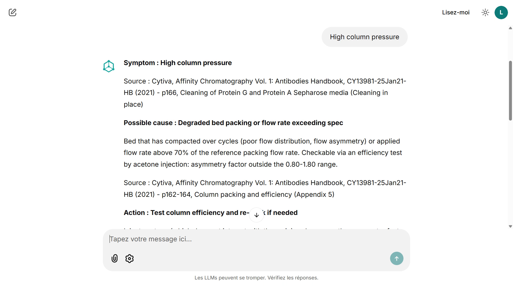
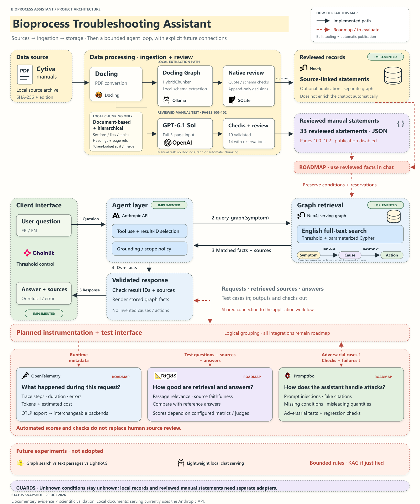

# Bioprocess Troubleshooting Assistant

Find handbook guidance when a Protein A capture chromatography run behaves
unexpectedly. This prototype helps bioprocess engineers and scientists inspect
possible causes, corrective actions, and their sources before deciding what to
check.

## Watch the demo

See the graph chat answer “High column pressure” with references to the Cytiva
handbook. The local demo uses Anthropic to select results from Neo4j. Chainlit
renders the selected graph facts and their citations.

[](https://mukunde.github.io/bioprocess-assistant/graph-chat/)

[Play the 27-second graph chat demo](https://mukunde.github.io/bioprocess-assistant/graph-chat/)

## Run locally

For the guided Cytiva demo, install Git and **CPython 3.13.0 x64** on Windows.
Run these commands in PowerShell.

```powershell
git clone https://github.com/mukunde/bioprocess-assistant.git
cd bioprocess-assistant
.\Install-CytivaDemo.ps1
.\Start-CytivaDemo.ps1 -CheckOnly
.\Start-CytivaDemo.ps1
```

Open [the local demo](http://127.0.0.1:8766/). Start with a washing-flow question,
then add maximum pressure and equilibration flow to see how the demo handles
missing or withheld evidence. For Protein A/G Sepharose, try
[the rising backpressure walkthrough](docs/validation/CYTIVA-TROUBLESHOOTING-DEMO.md).
The guided demo runs without model calls or a database. The installer downloads
verified Python packages and tokenizer data. [Setup and offline options](docs/DEMO-FIRST.md)

For model-assisted symptom search, set up Neo4j and Chainlit. Use
[`.env.example`](.env.example) to configure the local database, Chainlit sign-in,
and the Anthropic API key. [Graph chat setup](docs/LOCAL-GRAPH-CHAT.md)

Open the optional local trace viewer to see the Anthropic and Neo4j timeline,
token counts, and estimated model cost.
[Enable and view local traces](docs/LOCAL-GRAPH-CHAT.md#optional-local-traces)

## Architecture



| Path | How it works |
| --- | --- |
| Graph chat | Chainlit sends a question to the model. The model calls a Neo4j search tool and selects result IDs. The app validates the IDs and renders stored facts with citations. |
| Documentary demo | Guided controls or bounded English and French input select reviewed passages. The app renders source bundles and reports missing context or withheld evidence. |
| Evidence preparation | Docling converts the manual. Separate extraction experiments produce claims for human review. The graph chat uses a curated seed. |

[Architecture notes](docs/architecture/README.md) · [Grounding decision](docs/ADR-001-knowledge-graph-grounding.md) · [Ingestion guide](docs/INGESTION.md)

## Data and sources

The guided demo uses **25 reviewed Cytiva excerpts**. The public repository
includes selected excerpts and review records. [Cytiva experiment index](experiments/cytiva/README.md)

Two additional documentary modes have separate evidence and authority rules.
MabSelect uses an approved local registry. Protein A/G Sepharose remains staged
after a seven-case Chainlit replay. [MabSelect guide](docs/CHAINLIT-MABSELECT.md) · [Sepharose preview](docs/CHAINLIT-SEPHAROSE-CANDIDATE.md)

## Validation and results

| Check | Result | Evidence |
| --- | --- | --- |
| Software regressions at `73f2517` | 1,049 passed, one optional PDF preview test skipped | [Merged checkpoint](https://github.com/mukunde/bioprocess-assistant/pull/91) |
| Standalone backpressure demo | Four browser scenarios covered clarification, alternative treatments, product scope, and source navigation | [Dated validation record](docs/validation/CYTIVA-TROUBLESHOOTING-2026-10-30.md) |
| Graph chat benchmark | Two G01–G04 passes matched all eight expected outcomes. Median request latency was 3.97 s, and estimated total model cost was USD 0.089622. | [Replay results](docs/GRAPH-CHAT-MEASUREMENT.md#structured-output-replay) |
| Pressure validation | All six targeted cases conformed, including three abstentions for unconfirmed pressure. Estimated total model cost was USD 0.075246. | [Pressure results](docs/validation/GRAPH-CHAT-PRESSURE-VALIDATION.md#live-result) |
| Graph retrieval | The evaluation separates lexical retrieval from model-assisted checks and records errors and abstentions | [Evaluation inputs and commands](eval/README.md) |
| Cytiva XC01–XC12 | Expanded Neo4j covered 11/12 at 16 passages and 12/12 at 32. At 32, vector passage search reached 12/12 and LightRAG reached 11/12. | [Results and depth trade-off](docs/experiments/cytiva-expanded-heldout-results-v01.md) |

For expanded Neo4j, moving from 16 to 32 passages raised median total latency
from 26.75 to 71.28 ms and median evidence tokens from 1,295 to 2,720.5.
On AD01–AD10, the adaptive trigger expanded on all ten questions and
matched fixed 32 at 9/10 complete, with 118.58 versus 87.37 ms median total
latency and 2,705.5 median evidence tokens for both. XC06 recovered both
missing passages after expansion.
[Adaptive-depth results](docs/experiments/cytiva-neo4j-adaptive-depth-results-v01.md)

On SP01–SP08, product–procedure retrieval and fixed 32 both covered 8/8,
with median total latency of 129.83 and 125.07 ms, respectively. The
candidate recovered AD01 and preserved XC06, including its SuRe/SuRe LX
restriction. [Product and procedure results](docs/experiments/cytiva-neo4j-product-procedure-results-v01.md)

The offline answer-layer replay passed all 50 checks across both variants,
including AR01–AR06 and F01–F07. On AD01, product–procedure retrieval
supported both branches and fixed 32 abstained for MabSelect. Both
preserved the SuRe/SuRe LX restriction on XC06.
[Offline replay results](docs/experiments/cytiva-answer-layer-offline-results-v01.md)

The v04 documentary workflow passed 8/8 per retrieval variant on the
PE01–PE08 regression replay. The earlier v02 prospective trial scored
1/8 per variant on those questions. AD01 and XC06 passed their separate
regression checks and stayed outside both scores.
[v04 replay](docs/experiments/cytiva-documentary-v04-replay-results.md) · [v02 prospective results](docs/experiments/cytiva-documentary-v02-prospective-results.md)

Next, evaluate the frozen v04 on fresh questions with criteria fixed
before the run. [Roadmap](docs/ROADMAP.md#next-priority)

## Limitations

- Coverage is limited to the documented products and reviewed evidence.
- Citations support inspection. The prototype does not establish a diagnosis,
  verify scientific suitability, or authorize an operating procedure.
- The Windows installer was exercised in a fresh clone on the reference PC.
  Validation on a second physical PC is pending. [Second-PC protocol](docs/validation/WINDOWS-SECOND-PC.md)

## Documentation

[Documentation index](docs/README.md) · [Roadmap](docs/ROADMAP.md) · [Contribution and Markdown checks](AGENTS.md)

- `app.py`, `agent.py`, and `tools.py` handle graph chat and retrieval.
- `demo/` and `serving/` contain local demos and documentary serving.
- `ingestion/`, `eval/`, and `experiments/` contain the evidence pipeline and checks.

## Ownership and license

Gaël Mukunde maintains this project. [GitHub profile](https://github.com/mukunde)

[MIT license](LICENSE) for the project code. Cytiva manuals and third-party
assets retain their respective rights. [Graph demo recording](media/chainlit-graph-1080p/README.md) · [Diagram credits](docs/architecture/README.md)
