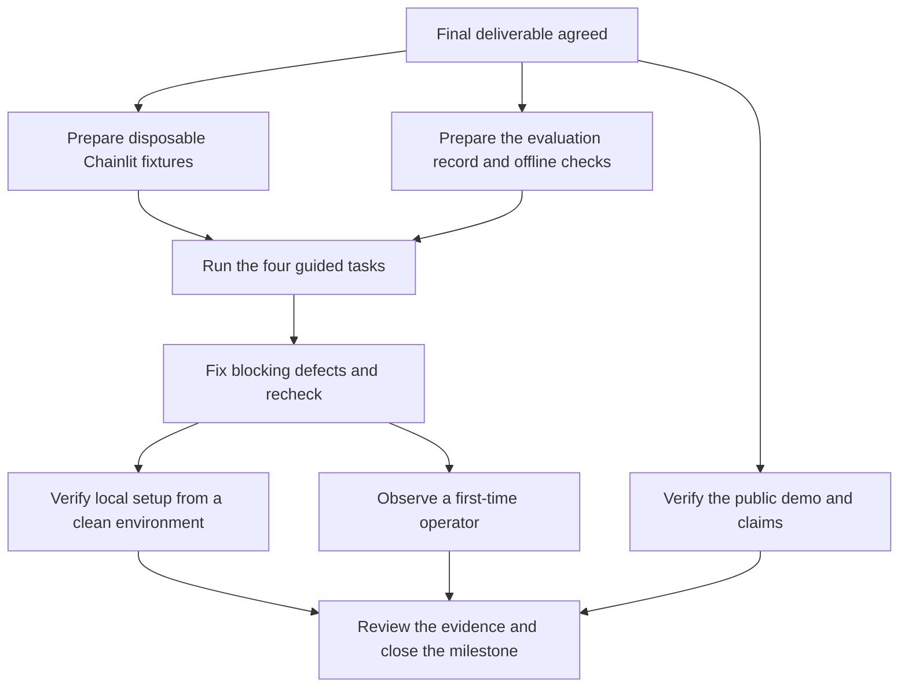

# Project finalization plan and results

Agreed destination: a public portfolio demo and a local guided Chainlit
pilot. The public demo shows graph chat with citations. The local pilot
lets a first-time operator use the reviewed MabSelect and Sepharose
documentary paths. Keep the scope limited to documentary guidance and
record any task that still needs assistance.

[Roadmap](ROADMAP.md#next-priority) · [Operator acceptance criteria](#before-closing)

## Challenge the roadmap

| Hypothesis | Evidence or risk | Decision for this milestone |
| --- | --- | --- |
| More retrieval tuning will deliver better answers | Both v10 variants assembled all required evidence on TV01–TV08 and scored 0/8. | Hold retrieval settings fixed. Reopen only if a guided task exposes a missing or unusable source. |
| Another successful replay is enough to expand free text | v11 scored 8/8 on the TV cases used to develop it. Performance on unseen formulations remains open. | Keep the free-text experiments available. Defer expansion. Reopen with a comparison against manually structured requests if free text becomes a release requirement. |
| The current recordings prove that an operator can use the product | A recording shows a successful path. It gives limited evidence of first-time usability, setup, and source navigation. | Test the actual guided UI with an independent participant and record where they stop. |
| A fresh clone can run the same guided experience | The standalone Windows demo has a setup path. Guided Chainlit uses authority or candidate data with separate prerequisites. | Verify the exact release instructions from a clean environment with disposable data. State any prerequisite or limitation explicitly. |
| A wider corpus or more evaluation tooling is essential now | The four guided tasks already exercise the product claim on reviewed evidence. | Defer new extraction, retrieval frameworks, and model-based evaluators until a specific failure justifies one. |

## Task graph

Independent work can run concurrently. Give fixture preparation, evaluation,
and the public demo separate owners or worktrees. Once the guided
journeys pass, Windows setup verification and the operator test can run
concurrently with separate fixtures and browser sessions.

| Task | Deliverable | Completion evidence |
| --- | --- | --- |
| Final deliverable agreed | Public portfolio demo and local guided Chainlit pilot. | Scope agreed with the project owner. |
| Prepare disposable Chainlit fixtures | A reproducible setup for approved MabSelect test data and two separate Sepharose previews. | Each mode opens from the instructions. The simulated withdrawal uses its own fixture. |
| Prepare the evaluation record and offline checks | Use GC01–GC04 and their expected outcomes. Identify existing callback and service tests for each task. | Each task has a named evidence check and a place to record help, retries, and the first blocker. |
| Verify the public demo and claims | Check the README entry point and video playback. Review the public claims against demonstrated features. | A reviewer can tell what the demo does and play it. Product claims match the observed evidence. |
| Verify local setup from a clean environment | Follow the exact guided Chainlit instructions from a clean clone or environment. | Record the tested configuration and outcome. Capture missing prerequisites and any manual steps. |
| Run the four guided tasks | Capture a maintainer walkthrough and verify UI outcomes, citations, and isolation. | All four tasks have a recorded result. Known issues are reproducible. |
| Fix blocking defects and recheck | Address only failures of task completion, documentary scope, safety, citation access, or setup. | A regression test at the affected boundary and a browser recheck of the affected task. |
| Observe a first-time operator | Give the operator the prompts and entry point to a running pilot with disposable data. Verify installation in a separate clean Windows session. | All four documentary checks pass. The operator completes the tasks and correctly explains the outcomes without intervention. |
| Review and close | Publish a short results record and mark the chosen milestone complete or blocked. | Include the validated scope, known limits, and any decision that remains. |

## Evaluation loop

1. Record the version, fixture IDs, setup, and expected outcomes before running.
2. Run offline callback and service checks, then the browser walkthrough.
   Capture completion, the operator's interpretation, assistance, retries, time, and any failure of scope,
   safety, or citation verification. Use timing to locate friction.
3. Fix the first demonstrated blocking defect at the smallest supported
   boundary. Add a regression test and rerun the affected journey and its
   dependent checks.
4. Once the walkthrough passes, observe an independent operator. If feedback
   reveals a blocker, capture it as a task and decide whether to fix it or
   narrow the release scope. Recheck with someone unfamiliar when a change
   affects discoverability.
5. Close the milestone once the release instructions, public demo, documentary
   checks, and independent operator evidence satisfy the agreed scope.
   After two correction rounds with the same blocker, pause that branch and
   make a scope or design decision before creating more cases.

### Offline baseline

On 15 November 2026, all 60 tests passed across the MabSelect and
Sepharose Chainlit callbacks and the Sepharose candidate service.
The usual verification environment could not import the Chainlit tests
because it lacked the Neo4j driver. The existing graph-chat environment
ran the tests with outbound connections and model calls guarded by the
test fixtures. Use a short Windows temporary root for these tests.
This baseline preceded the browser walkthrough and the fresh-clone
installation below.

## Finalization results

| Deliverable | Status on 15 November 2026 | Evidence |
| --- | --- | --- |
| Public showcase | Verified | The README thumbnail opens the 27-second graph-chat recording in GitHub Pages. Playback reached the end at 1080p with readable Cytiva citations. The player credits Claude Sonnet 4.6 via the Anthropic API, and the repository description describes the prototype and its sources. [Public demo](https://mukunde.github.io/bioprocess-assistant/graph-chat/) · [PR #139](https://github.com/mukunde/bioprocess-assistant/pull/139) |
| Guided journeys and Git checks | Merged and verified | The maintainer walkthrough passed all four documentary checks. PR #140 merged the Chainlit UI corrections, staged secret scanning, and commit-subject checks. [PR #140](https://github.com/mukunde/bioprocess-assistant/pull/140) |
| Windows pilot setup | Verified on the reference PC | Fresh clone of merged `main` at `2bbacc1`, with CPython 3.13.0 x64 and Chainlit 2.12.0 in a new virtual environment. The documented launcher started all three disposable instances. All 40 focused tests passed. The browser recheck opened E167-S, confirmed the pressure abstention, and verified that E166-D remained accessible after the simulated withdrawal. The initial readiness probe expired during cold startup. All three instances then responded. [Windows setup](https://github.com/mukunde/bioprocess-assistant/blob/main/docs/CHAINLIT-GUIDED-PILOT.md) |
| Independent operator | Passed on 16 November 2026 | One participant completed all four tasks without assistance on their successful attempts. GC01 and GC02 required retries. [Operator results](#independent-operator-results) |

## Independent operator results

The participant used the running local pilot with disposable data. They
completed all four tasks without assistance on their successful attempts.

| Task | Outcome | What the participant demonstrated |
| --- | --- | --- |
| GC01 | Pass on retry | Identified the missing product variant, opened E167-S, and explained its scope for SuRe LX. The observer read the column label on request as specified in the scenario. |
| GC02 | Pass on retry | Opened E167-S and explained that the absence of a numerical pressure limit applies to the selected excerpts. |
| GC03 | Pass | Opened E166-P and distinguished the explored deposit scenario from a confirmed diagnosis. |
| GC04 | Pass | Opened E166-D in the second preview and explained that the ethanol option and its warning disappeared while the detergent option remained available. |

Early GC01 attempts exposed duplicate submit buttons and a citation view
that drew attention to JSON. The revised interface addressed both issues.
The first GC02 submission left the context unspecified and the pilot
asked for clarification. The evaluation involved one participant. The
result includes retries and no task timings were recorded.

## Tested interface

The operator used the uncommitted local UI changes on top of local Git
revision `e12d225` with CPython 3.13.0 x64 and Chainlit 2.12.0. The
MabSelect fixture was `chat-ui-demo`. The staged Sepharose fixtures were
`chat-ui-candidate-final` and `chat-ui-withdrawal-final`. The prepared UI
changes apply to `main` at `267fa37`. Both Sepharose fixture manifests match
the code and source files in that checkout.

Hashes use SHA-256 after CRLF-to-LF normalization.

| Interface file | Tested SHA-256 |
| --- | --- |
| `app.py` | `9ca43e9496d560c55cdf41326ad8ea5ebe298067d69a0fb287b4207602068f7b` |
| `demo/chainlit_mabselect.py` | `fdc02dc538398f609a9cee82604011b421fcf01ea567f2572175792906f54a30` |
| `demo/chainlit_sepharose.py` | `06c4307fb9f4c9edd7e71b6107612a537b724e26e2c9279cc8b5037ce8968e6c` |
| `public/custom.css` | `4f8f7801fb202f08f1223f54fab69076718f60844cc4a2f63746a98f8b798a09` |
| `public/documentary.css` | `57f867e92e45e4ce5f6ff2f89f7ce261595f66ce6b24353f8a69efde012f5251` |
| `.chainlit/config.toml` | `745ee77edda7921b226b17cc40c3afd68880cb604b30ff8c81864623a37a6fae` |
| `public/login.js` | `f94a6dcfc35290dae3ff7a4e6adf596f3e559bbe8ee0d07953bb25435363004a` |

## Before closing

| Task | What the operator must demonstrate |
| --- | --- |
| GC01 | Identify the missing MabSelect variant, keep the selected context, and open the applicable source after choosing SuRe LX. |
| GC02 | Find the cleaning citation and explain why the selected excerpts do not establish a numerical pressure limit. |
| GC03 | Open E166-P for Protein G Sepharose and explain the distinction between the explored deposit and a diagnosis. |
| GC04 | Compare fresh Sepharose previews, identify the withheld option, and open E166-D for the remaining option. |

The operator test is complete. Merge the reviewed UI and documentation,
then compare the interface on `main` with the hashes above and confirm
the disposable pilot starts from the published setup. Record the release
revision when closing the milestone. The verified scope is the public
showcase and the local guided documentary pilot.

A local pilot uses local credentials and reviewed data. External access or
operational use would require a separate decision about audience, data,
hosting, and validation.
